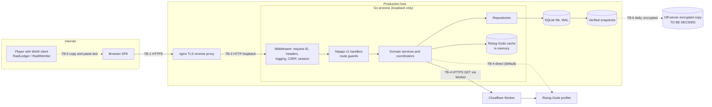
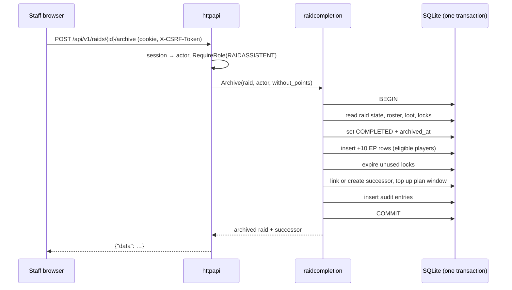

# Architecture — raid-website

This file owns HOW the system is built: components, boundaries, technology choices, data
ownership, data flow, and dependency rules. Behaviour is owned by `REQUIREMENTS.md`, look and
interaction by `DESIGN.md`, and security controls by `SECURITY.md`; this file references their
IDs instead of restating them. It describes the code of v1.0.27 (2026-10-22). Choices that
the owner made on 2026-10-22 and that the code does not follow yet are marked
"Owner 2026-10-22" and "not built". ADRs keep the history of each decision.

## Required Architecture Inputs

- Requirements source: `REQUIREMENTS.md`
- Design source: `DESIGN.md`
- Target surfaces: one responsive web application (desktop and mobile browsers) with a JSON API; copy-and-paste text exchange with two WoW 3.3.5a addons. No native mobile app.
- Runtime and deployment environment: one Linux host; one Go process behind a TLS reverse proxy (nginx), started by systemd; SQLite database file on local disk; a Cloudflare Worker for Rising-Gods egress. Operational detail is in `deploy/README.md`.
- Server framework: Go standard library `net/http` with the Go 1.22+ method-pattern `ServeMux`; Go 1.26.
- Server runtime: Go 1.26 (CI uses 1.26.x); single statically linked binary that embeds the SPA, migrations, loot catalog, and addon bundles.
- Client framework(s): React 18.3 with TypeScript 5.6 (strict), built by Vite 8.3; no router, state, or HTTP library. Runtime libraries: `recharts` 3 (charts), `qrcode` 1.5 (TOTP setup QR).
- API style and integration model: JSON over HTTP under `/api/v1`, snake_case, `{"data": …}` / `{"error": {"code", "message"}}` envelopes with a stable, unlocalised `code`, RFC3339 UTC timestamps, lists always `[]` and never `null`, same-origin cookie session. A new API version is a new package, never a change to `/api/v1` contracts. Rising-Gods: outbound HTTPS GET, direct or through the Worker. Addons: versioned plain-text formats RS1, RS2, WL2 carried by a person.
- Authentication and session model: local accounts with optional TOTP, recovery codes, and WebAuthn; opaque server-side sessions in a cookie; CSRF token for state-changing requests. Mechanisms and values: `SECURITY.md` SC-005 to SC-019.
- Data model and scale expectations: one guild; tens of players, hundreds of characters, a few raids per week. SQLite with one open connection, so all writes are serialized. Exact scale targets: UNKNOWN (none stated).
- Security expectations: deferred to `SECURITY.md`.

## Architecture and Decisions

- **Modular monolith (ADR 001).** One Go module, one process, one database. Each business
  capability is a package under `internal/<domain>`; there are no network calls between
  components.
- **Layers (ADR 002; DR-1, DR-5, DR-6).** HTTP layer → domain services → domain repositories →
  database. Handlers decode, check the route guard, delegate, and encode. Business rules live in
  domain services. Bun ORM and SQL live in repositories (DR-4).
- **Coordinators for cross-domain writes.** `raidcorrection` (roster, loot, corrections,
  quick-add, withdrawal), `raidcompletion` (archive), `raidsignup` (acceptance),
  `accountmerge`, and `addonsync` (imports) orchestrate several domains inside one database
  transaction that is opened by a repository and passed down with `WithTx`.
- **Persistence.** SQLite via Bun v1.3 (`sqlitedialect` + `sqliteshim`, which selects the pure-Go
  `modernc.org/sqlite` driver), WAL journal, foreign keys forced on every connection, `SetMaxOpenConns(1)`. Schema is
  changed only by numbered, embedded, forward-only migration files (`internal/migrations`).
  Timestamps are stored in UTC (ADR 003).
- **Append-only history.** EP transactions and the audit log are only inserted; corrections add
  compensating rows (FR-16.1, FR-26.1). History rows are archived (`archived_at`, `removed_at`,
  `withdrawn_at`); the only hard deletes are listed in FR-31.2.
- **Bundled read-only data.** The loot catalog JSON (ADR 027) and the addon bundles (ADR 085)
  are embedded in the binary and validated at startup; invalid data stops startup (NFR-1.1).
  The catalog is `scripts/data/catalog-wotlk335.json` (AtlasLoot/Wowhead data, English item
  stats, German names), generated by `scripts/build_loot_db_localized.py` from
  `scripts/lootcatalog.localized.json`; it currently covers Icecrown Citadel only. Each startup
  mirrors it into the foreign-key tables and records a report in `loot_catalog_initializations`.
- **Frontend.** A single-page app with a hash router (`#/raids/12`) and one fetch wrapper
  (`web/src/api.ts`) that sends `credentials: 'include'` and the CSRF header. Vite builds it into
  `internal/webui/dist`, which the Go binary embeds and serves for `/`; the frontend is built
  before the binary. In development Vite proxies `/api` to `:8080`.
- **Sessions and identity.** The `authenticate` middleware resolves the session cookie into the
  actor on the request context; route guards `RequireAuth` and `RequireRole(role)` enforce the
  role matrix (FR-1.*); domain services re-check ownership where a rule depends on it (for
  example own locks, own wishlist).
- **In-process state.** The Rising-Gods search cache, request coalescing, and the visitor
  search counter (FR-7.6, per client address, reset on restart) are in memory (Owner 2026-10-22, AQ-7).
  Login attempts, sessions, and MFA challenges are in the database. The design therefore
  assumes exactly one application process (DR-9).
- **Server lifecycle.** The HTTP server sets read-header, read, write, and idle timeouts and
  shuts down gracefully on SIGTERM, finishing running requests (Owner 2026-10-22, AQ-3); the values
  are owned by `SECURITY.md`. Not built: the code calls `http.ListenAndServe` without them.
- **Statistics.** A public `GET /api/v1/statistics` returns only server-computed aggregates
  (FR-27.2); the statistics page reads only this endpoint (Owner 2026-10-22, AQ-2). Not built: the
  page now computes figures in the browser from login-only and per-raid loot endpoints.
  Response contract (FR-27.3), all counts integers:
  `raids_by_status` (`[{status, count}]`), `class_distribution` (`[{class, count}]`),
  `role_history` (`[{role, count}]`), `loot_by_class` (`[{class, count}]`),
  `top_attendance` and `top_loot` (`[{player_id, player_name, count}]`, at most 10 each).
  Order and inclusion: FR-27.4 and FR-27.5 (computed in SQL `ORDER BY count DESC, name, id`
  with SQLite's default `BINARY` collation, which is UTF-8 byte order).
  A contract test MUST check, without a session, that the response has exactly these fields and
  that no item, EP, note, or login field appears, and that two players with the same count are
  ordered by name and then ID.
- **Operator reset command.** A new `cmd/reset-code` opens the database with the server's
  configuration and calls the `registration` reset-code service directly, like `cmd/sync-addons`
  calls `internal/addons`; it has no HTTP surface (SC-051, OD-019). Not built.
- **Privacy.** `accountmerge` gains an Admin-only anonymise operation (FR-30.2–30.5). The privacy
  page is a static frontend page; its contact name and address come from two new configuration
  values, read by `internal/config`, and reach the page through a public read endpoint
  `GET /api/v1/privacy-contact` (Owner 2026-10-22, AQ-6; endpoint confirmed 2026-10-23, backlog #49).
  Not built.
- **Boss kills.** A new `bosskill` domain package owns `raid_boss_kills` (raid, catalog boss,
  difficulty; unique per raid and boss). `loot` reads the kill for the award difficulty.
  `raidcorrection` writes kills, so the manual loot path and the `addonsync` import create a
  missing kill and the loot in one transaction (FR-29.7, FR-29.8) (Owner 2026-10-22, AQ-5). Not built.
- **Public interface.** Without a session, only these reads answer (FR-1.2): `GET /api/v1/raids`,
  `/players`, `/polls`, `/raids/{id}/attendance`, `/addons`, `/addons/{name}/download`,
  `/external/rising-gods/characters`, `/health` (also `/health` at the root), `/auth/csrf`, and, not
  built, `/statistics` and `/privacy-contact`. Login, MFA, and registration writes are public too.
- **API notes.** Catalog reads: `GET /api/v1/loot-catalog` and its `/instances`, `/bosses`,
  `/items`; there are no catalog write endpoints. Raid series: `weekdays` are 0 (Sunday) to 6
  (Saturday), `start_time` is `HH:MM`, `timezone` an IANA name. `PATCH /api/v1/raids/{id}` takes
  `series_id` and/or `scheduled_start` (RFC3339); omitted fields stay unchanged.
  `POST /api/v1/raids/{id}/archive` returns the raid in `data` and its successor in `next_raid`.
  Loot DTOs carry `award_method`, never a client-set `is_main_spec`.
- **Security events and account recovery.** Security events are written as structured lines to
  the systemd journal, which keeps them 30 days (SC-041). Password-reset codes reuse the
  registration-code infrastructure in `registration` (owner 2026-10-23, backlog #48), and the personal-data export
  (FR-30.7) lives in `accountmerge` next to anonymisation (owner 2026-10-23, backlog #50). (Owner 2026-10-23.) Not built.
- **No background jobs.** Deadlines (signup close, MFA expiry) are evaluated on each request.
  Planning ahead runs on series save and archive (FR-9.7). The only periodic work is on the host
  (backups, updates, reboots; see `deploy/`).

## Components and Flows

Status describes the specification: `SUPPORTED` = fully specified; `PARTIALLY DEFINED` =
specified with an open architecture item; `TO BE DECIDED` = no architecture yet. "(not built)"
and similar notes say which specified parts the code does not have yet. All rows are
`SUPPORTED` after the owner's answers of 2026-10-22.

| Component | Responsibility | Business rules enforced | Data owned | Requirements | Status |
| --- | --- | --- | --- | --- | --- |
| Web client (`web/src`) | Pages, forms, hash routing, German UI, local drafts | None authoritative; convenience checks only | Browser drafts (`localStorage`) | FR-28, `DESIGN.md` | SUPPORTED |
| HTTP layer (`httpapi`, `httpapi/v1`) | Middleware chain, route guards, DTOs, error mapping, SPA and health, server timeouts | Role matrix, session presence, CSRF, body size | None | FR-1, FR-2.8, NFR-4.1, NFR-4.2 | SUPPORTED (timeouts not built) |
| `auth` | Login, sessions, passwords, TOTP, recovery codes, WebAuthn, bootstrap admin | Password length, login rate limit, MFA challenge expiry | sessions, login attempts, MFA secrets and credentials, password hash | FR-2, FR-3 | SUPPORTED |
| `registration` | Rising-Gods client and cache; registration requests, codes, claims; visitor search counter | Alliance level-80 filter, request deduplication, code expiry, visitor search limit | registration requests, codes, external profiles | FR-4, FR-7 | SUPPORTED (search limit not built; unused warmer to delete) |
| `player` | Players, roles, public player view | Public field subset | players | FR-1.3, FR-1.9, FR-5.1–5.2 | SUPPORTED |
| `character` | Characters, name history, merge aliases, transfer | Rising-Gods provenance uniqueness, merge conflicts | characters, name history, aliases | FR-6 | SUPPORTED |
| `accountmerge` | Player merge; player anonymisation | Same-item lock conflict, credential retention; data deleted versus kept | (coordinator) | FR-5.3–5.7, FR-30.2–30.5 | SUPPORTED (anonymise not built) |
| `roster` | Guild ranks and raid groups | Configurable rows only | guild ranks, raid groups | FR-8.1 | SUPPORTED |
| `lootcatalog` | Embedded catalog, startup mirror, boss order | Mode normalisation, catalog pair validity, full boss order | catalog mirror, initialisation reports, boss order | FR-8.2–8.3, FR-25 | SUPPORTED |
| `raidseries` | Series configuration, recurrence calendar, planning | Local-week anchoring, DST errors, 520-week guard | raid series | FR-9 | SUPPORTED |
| `raid` | Raids, schedule, cancel, current raid | Name from template, status transitions for cancel | raids | FR-10.1–10.5, FR-11.1 | SUPPORTED |
| `raidsignup` | Signup availability, choices, acceptance, absences | Deadline, ownership, one accepted character | signups, absences | FR-12 | SUPPORTED |
| `attendance` | Roster rows with per-raid snapshots | Snapshot completeness | raid attendance | FR-13.2–13.4 | SUPPORTED |
| `raidcorrection` | Roster and loot writes, corrections, withdrawal, quick-add | Raid-state rules, archived reason, EP eligibility delta, retry receipts | quick-add receipts (coordinator otherwise) | FR-13, FR-14.8–14.10, FR-16.5–16.6 | SUPPORTED |
| `loot` | Loot awards, methods, enhanced cost, lock auto-award, token derivation | Roster recipient, request-ID idempotency, cost formula | loot awards | FR-14, FR-18 | SUPPORTED |
| `unclaimedloot` | Items that went to nobody | No player effect | unclaimed loot | FR-15 | SUPPORTED (SQL to move, DR-4) |
| `enhancepoints` | EP ledger, balances, item locks | 150-EP lock threshold, competing locks, ownership | EP transactions, item locks | FR-16, FR-17 | SUPPORTED |
| `raidcompletion` | Archive: EP award, lock expiry, successor, plan-ahead top-up, preview | Idempotent finalisation, exclusions, successor conflicts | (coordinator) | FR-10.6–10.15 | SUPPORTED |
| `addonsync` | RS1/RS2 parsing, roster and loot import previews and applies, invite export | Raid-scoped request IDs, importable states | (coordinator) | FR-20 | SUPPORTED |
| `addons` | Embedded addon bundles and download zips | Bundle completeness | embedded files | FR-21 | SUPPORTED |
| `wishlist` | Wishlist items, raid interests, WL2 export | Owner-only writes | wishlist items | FR-19, FR-20.13 | SUPPORTED |
| `shadowmourne` | Questline list and raid task choices | Eligible classes, stage choice rules | entries, raid tasks | FR-22 | SUPPORTED |
| `recruitment` | Recruitment template per series or raid | Length, shape, slot values | recruitment templates | FR-23 | SUPPORTED (slot check and SQL move not built) |
| `poll` | Polls and votes | Option validity, closed polls | polls, options, votes | FR-24 | SUPPORTED |
| `audit` | Audit writer and Admin reader | Append-only, no secrets in snapshots | audit log | FR-26 | SUPPORTED |
| Statistics (`GET /api/v1/statistics`, `internal/statistics`) | Public aggregates computed on the server | Public field subset (FR-27.2) | none (derived, read-only) | FR-27 | SUPPORTED |
| `bosskill` | Kill list per raid, difficulty per boss | One kill per boss, catalog difficulties, loot blocks removal | raid boss kills | FR-29 | SUPPORTED (not built) |
| Privacy page | Static page with contact from configuration | None | none | FR-30.1 | SUPPORTED (not built) |
| Infrastructure (`config`, `db`, `migrations`, `validation`, `webui`) | Environment config, DB open, schema, enums, embedded SPA | Production config rules, foreign keys, SPA present in production | schema | NFR-1 | SUPPORTED (SPA check not built) |
| Rising-Gods Worker (`workers/`) | Authenticated fixed-origin GET proxy to `db.rising-gods.de` | Fixed origin and shared token (SC-029) | none | FR-7, ADR 048, ADR 053 | SUPPORTED |

### Main data flows

1. **Read a page.** Browser → reverse proxy → middleware chain (request ID → security headers →
   logging → CSRF → session) → route guard → handler → domain repository → SQLite → JSON
   envelope → browser renders it as text.
2. **Change data.** Same path; the client first gets a CSRF token (`GET /api/v1/auth/csrf`) and
   sends it as `X-CSRF-Token` (SC-019). The handler passes the actor from the context to a domain service
   or coordinator, which opens one transaction for the record, its ledger consequences, and its
   audit entry.
3. **Archive a raid.** Staff → `raidcompletion` → in one transaction: lifecycle, +10 EP rows,
   lock expiry, successor link or creation, plan-ahead top-up, audit (FR-10.8).
4. **Register a player.** Visitor → Rising-Gods search (cache, else Rising-Gods directly or via the
   Worker) → registration request → Admin creates a code → the code is delivered in game by a
   person → visitor redeems it → account, character link, and session (FR-4).
5. **Addon exchange.** Website → invite text → person pastes it into RaidLedger. RaidLedger →
   roster or loot text → person pastes it into the website → preview (no writes) → apply through
   the ordinary roster and loot paths (FR-20). Wishlist: website → WL2 text → RaidWishlist.

### Trust boundaries

- **TB-1 Internet → reverse proxy.** TLS termination; the only network entry point.
- **TB-2 Reverse proxy → application.** Loopback only (SC-025); which forwarded headers are
  trusted: SC-006, SC-007.
- **TB-3 Browser → API.** Everything from the browser is untrusted: identity comes only from the
  session cookie, permissions only from the server (FR-1.1).
- **TB-4 Application → Rising-Gods / Worker.** Responses are untrusted input; a chosen profile is
  reloaded before it is stored (FR-7.4).
- **TB-5 Addon text → application.** Pasted RS1/RS2 text is untrusted, is previewed without
  writes, and is applied only through the ordinary validated paths (FR-20.3, FR-20.6).
- **TB-6 Application → SQLite file and snapshots.** Local file permissions of the service account;
  snapshots leave the host encrypted (NFR-2.3).
- **TB-7 Build and deploy.** Code from `main` is built by an unprivileged build account; a fixed
  root-owned publisher installs it (ADR 071, ADR 072). The design depends on a protected `main`
  (SC-039) and on committed, reviewed deploy scripts in `deploy/bin/` (SC-037); neither holds today
  (T-012, T-013).

Controls at each boundary are defined in `SECURITY.md`; the threats that cross each boundary are
in `THREAT_MODEL.md` ("Trust boundaries to threats").

## Dependency Rules

- **DR-1** Imports point inward only: `cmd/*` → `internal/httpapi` → `internal/<domain>` →
  infrastructure (`db`, `migrations`, `validation`, `config`). No domain package imports
  `httpapi`. Production code follows this today; test files may import `httpapi`.
- **DR-2** Go forbids import cycles; coordinators (`raidcorrection`, `raidcompletion`,
  `raidsignup`, `accountmerge`, `addonsync`) may import the domains they orchestrate, and
  orchestrated domains never import their coordinator.
- **DR-3** Each table has exactly one owning domain package (the "Data owned" column). Only the
  owner's repository writes it; other components call the owner's repository or service.
- **DR-4** SQL and Bun query builders appear only in `repo.go` files. Models may carry Bun struct
  tags. There are no exceptions (Owner 2026-10-22, AQ-1). Not yet followed by
  `internal/character/merge.go`, `internal/lootcatalog/order.go`, `internal/recruitment/service.go`
  and `internal/unclaimedloot/unclaimed.go`; their queries move into `repo.go`.
- **DR-5** A write that touches more than one row or table, including its audit entry and ledger
  rows, runs in one transaction passed down with `WithTx`.
- **DR-6** Business rules live in domain services, never in handlers, middleware, or the web
  client. Handlers do not compute ledger values or derive statuses.
- **DR-7** Configuration is read only in `internal/config` and passed to components.
- **DR-8** Vendor-specific code stays at the edge: Rising-Gods HTTP in `registration`, WebAuthn in
  `auth`, addon formats in `addonsync` and `wishlist`, the Cloudflare Worker in `workers/`.
- **DR-9** The application runs as exactly one process. In-memory state (Rising-Gods cache, any
  future rate limiter) is allowed only under this rule.
- **DR-10** The web client talks to the server only through `web/src/api.ts` and only to
  same-origin `/api/v1`.
- **DR-11** A new Go or npm dependency needs owner approval. `go.mod` stays tidy
  (`go mod tidy`), so direct dependencies are not marked `// indirect` (Owner 2026-10-22, AQ-8).
- **DR-12** Code that nothing imports or calls is deleted, not kept switched off; Git history keeps
  it. Not yet followed by `internal/registration/rising_gods_warm.go` and `internal/logger`
  (Owner 2026-10-22, AQ-4 and AQ-8).
- **DR-13** The embedded web build (`index.html`) is checked at startup like the catalog and addon
  bundles; the production rule is NFR-1.1. Development without a web build keeps working
  (Owner 2026-10-22, AQ-3).

## Open Questions

None open. The owner resolved AQ-1 to AQ-8 on 2026-10-22; the answers are in the rules marked
"Owner 2026-10-22". IDs are not reused.

- **AQ-1** SQL moves into `repo.go`; DR-4 has no exceptions.
- **AQ-2** Public `GET /api/v1/statistics` with server-side aggregates.
- **AQ-3** HTTP timeouts and graceful shutdown; no production start without the web build (DR-13).
- **AQ-4** Delete the unused Rising-Gods cache warmer (DR-12).
- **AQ-5** New `bosskill` package, written through `raidcorrection`.
- **AQ-6** Anonymise in `accountmerge`; privacy contact from configuration.
- **AQ-7** Visitor search counter in memory.
- **AQ-8** `go mod tidy`, delete `internal/logger` (DR-11, DR-12).
