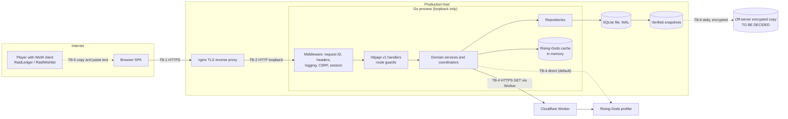
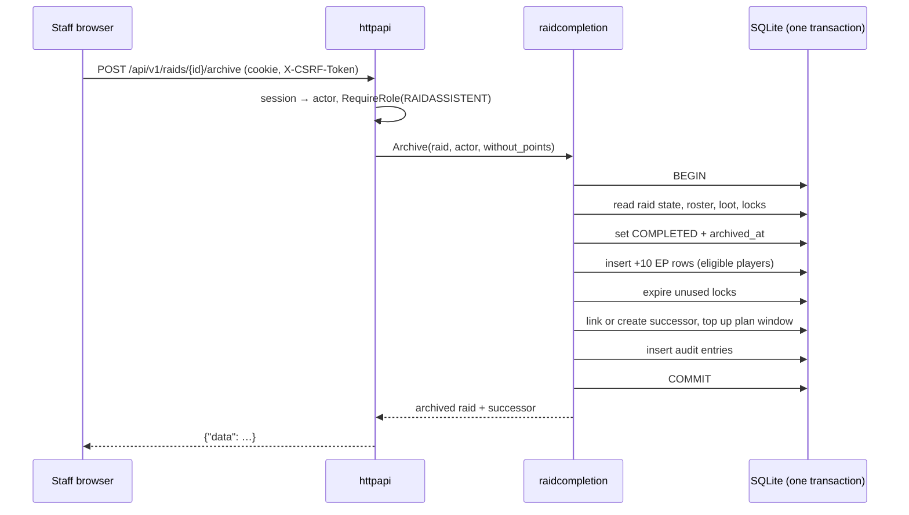

# Architecture — raid-website

This file owns HOW the system is built: components, boundaries, technology choices, data
ownership, data flow, and dependency rules. Behaviour is owned by `REQUIREMENTS.md`, look and
interaction by `DESIGN.md`, and security controls by `SECURITY.md`; this file references their
IDs instead of restating them. It describes the code of v1.0.27 (2026-10-22). Choices for
features decided on 2026-10-22 that the code does not have yet are marked `PROPOSED` or
`TO BE DECIDED`. ADRs keep the history of each decision.

## Required Architecture Inputs

- Requirements source: `REQUIREMENTS.md`
- Design source: `DESIGN.md`
- Target surfaces: one responsive web application (desktop and mobile browsers) with a JSON API; copy-and-paste text exchange with two WoW 3.3.5a addons. No native mobile app.
- Runtime and deployment environment: one Linux host; one Go process behind a TLS reverse proxy (nginx), started by systemd; SQLite database file on local disk; a Cloudflare Worker for Rising-Gods egress. Operational detail is in `deploy/README.md`.
- Server framework: Go standard library `net/http` with the Go 1.22+ method-pattern `ServeMux`; Go 1.26.
- Server runtime: Go 1.26 (CI uses 1.26.x); single statically linked binary that embeds the SPA, migrations, loot catalog, and addon bundles.
- Client framework(s): React 18.3 with TypeScript 5.6 (strict), built by Vite 8.3; no router, state, or HTTP library. Runtime libraries: `recharts` 3 (charts), `qrcode` 1.5 (TOTP setup QR).
- API style and integration model: JSON over HTTP under `/api/v1`, snake_case, `{"data": …}` / `{"error": {"code", "message"}}` envelopes, same-origin cookie session. Rising-Gods: outbound HTTPS GET, direct or through the Worker. Addons: versioned plain-text formats RS1, RS2, WL2 carried by a person.
- Authentication and session model: local accounts (bcrypt), optional TOTP, recovery codes, and WebAuthn; opaque random session token stored hashed in the database and sent as an `HttpOnly` cookie; CSRF token for state-changing requests. Detailed controls: `SECURITY.md`.
- Data model and scale expectations: one guild; tens of players, hundreds of characters, a few raids per week. SQLite with one open connection, so all writes are serialized. Exact scale targets: UNKNOWN (none stated).
- Security expectations: deferred to `SECURITY.md`.

## Architecture and Decisions

- **Modular monolith (ADR 001).** One Go module, one process, one database. Each business
  capability is a package under `internal/<domain>`; there are no network calls between
  components.
- **Layers (ADR 002, CODING_RULES §6).** HTTP layer → domain services → domain repositories →
  database. Handlers decode, check the route guard, delegate, and encode. Business rules live in
  domain services. Bun ORM and SQL live in repositories (see AQ-1 for exceptions).
- **Coordinators for cross-domain writes.** `raidcorrection` (roster, loot, corrections,
  quick-add, withdrawal), `raidcompletion` (archive), `raidsignup` (acceptance),
  `accountmerge`, and `addonsync` (imports) orchestrate several domains inside one database
  transaction that is opened by a repository and passed down with `WithTx`.
- **Persistence.** SQLite via Bun v1.3 (`sqlitedialect` + `sqliteshim`, which selects the pure-Go
  `modernc.org/sqlite` driver), WAL journal, foreign keys forced on every connection, `SetMaxOpenConns(1)`. Schema is
  changed only by numbered, embedded, forward-only migration files (`internal/migrations`).
  Timestamps are stored in UTC (ADR 003).
- **Append-only history.** EP transactions and the audit log are only inserted; corrections add
  compensating rows (FR-16.1, FR-26.1). History rows are archived (`archived_at`, `removed_at`,
  `withdrawn_at`), with the explicit hard-delete exceptions in FR-5.5, FR-6.10, and FR-13.7.
- **Bundled read-only data.** The loot catalog JSON (ADR 027) and the addon bundles (ADR 085)
  are embedded in the binary and validated at startup; invalid data stops startup (NFR-1.1).
- **Frontend.** A single-page app with a hash router (`#/raids/12`) and one fetch wrapper
  (`web/src/api.ts`) that sends `credentials: 'include'` and the CSRF header. Vite builds it into
  `internal/webui/dist`, which the Go binary embeds and serves for `/`; the frontend is built
  before the binary. In development Vite proxies `/api` to `:8080`.
- **Sessions and identity.** The `authenticate` middleware resolves the session cookie into the
  actor on the request context; route guards `RequireAuth` and `RequireRole(role)` enforce the
  role matrix (FR-1.*); domain services re-check ownership where a rule depends on it (for
  example own locks, own wishlist).
- **In-process state.** The Rising-Gods search cache and request coalescing are in memory.
  Login attempts, sessions, and MFA challenges are in the database. The design therefore
  assumes exactly one application process (DR-9).
- **No background jobs.** Deadlines (signup close, MFA expiry) are evaluated on each request.
  Planning ahead runs on series save and archive (FR-9.7). The only periodic work is on the host
  (backups, updates, reboots; see `deploy/`).

## Components and Flows

Status: `SUPPORTED` = built and specified; `PARTIALLY DEFINED` = built, with an open
architecture item; `TO BE DECIDED` = specified in `REQUIREMENTS.md`, no component yet.

| Component | Responsibility | Business rules enforced | Data owned | Requirements | Status |
| --- | --- | --- | --- | --- | --- |
| Web client (`web/src`) | Pages, forms, hash routing, German UI, local drafts | None authoritative; convenience checks only | Browser drafts (`localStorage`) | FR-28, `DESIGN.md` | SUPPORTED |
| HTTP layer (`httpapi`, `httpapi/v1`) | Middleware chain, route guards, DTOs, error mapping, SPA and health | Role matrix, session presence, CSRF, body size | None | FR-1, FR-2.8, NFR-4.1 | PARTIALLY DEFINED (AQ-3) |
| `auth` | Login, sessions, passwords, TOTP, recovery codes, WebAuthn, bootstrap admin | Password length, login rate limit, MFA challenge expiry | sessions, login attempts, MFA secrets and credentials, password hash | FR-2, FR-3 | SUPPORTED |
| `registration` | Rising-Gods client and cache; registration requests, codes, claims | Alliance level-80 filter, request deduplication, code expiry | registration requests, codes, external profiles | FR-4, FR-7 | PARTIALLY DEFINED (AQ-4, AQ-7) |
| `player` | Players, roles, public player view | Public field subset | players | FR-1.3, FR-1.9, FR-5.1–5.2 | SUPPORTED |
| `character` | Characters, name history, merge aliases, transfer | Rising-Gods provenance uniqueness, merge conflicts | characters, name history, aliases | FR-6 | SUPPORTED |
| `accountmerge` | Player merge | Same-item lock conflict, credential retention | (coordinator) | FR-5.3–5.7 | SUPPORTED |
| `roster` | Guild ranks and raid groups | Configurable rows only | guild ranks, raid groups | FR-8.1 | SUPPORTED |
| `lootcatalog` | Embedded catalog, startup mirror, boss order | Mode normalisation, catalog pair validity, full boss order | catalog mirror, initialisation reports, boss order | FR-8.2–8.3, FR-25 | SUPPORTED |
| `raidseries` | Series configuration, recurrence calendar, planning | Local-week anchoring, DST errors, 520-week guard | raid series | FR-9 | SUPPORTED |
| `raid` | Raids, schedule, cancel, current raid | Name from template, status transitions for cancel | raids | FR-10.1–10.5, FR-11.1 | SUPPORTED |
| `raidsignup` | Signup availability, choices, acceptance, absences | Deadline, ownership, one accepted character | signups, absences | FR-12 | SUPPORTED |
| `attendance` | Roster rows with per-raid snapshots | Snapshot completeness | raid attendance | FR-13.2–13.4 | SUPPORTED |
| `raidcorrection` | Roster and loot writes, corrections, withdrawal, quick-add | Raid-state rules, archived reason, EP eligibility delta, retry receipts | quick-add receipts (coordinator otherwise) | FR-13, FR-14.8–14.10, FR-16.5–16.6 | SUPPORTED |
| `loot` | Loot awards, methods, enhanced cost, lock auto-award, token derivation | Roster recipient, request-ID idempotency, cost formula | loot awards | FR-14, FR-18 | SUPPORTED |
| `unclaimedloot` | Items that went to nobody | No player effect | unclaimed loot | FR-15 | PARTIALLY DEFINED (AQ-1) |
| `enhancepoints` | EP ledger, balances, item locks | 150-EP lock threshold, competing locks, ownership | EP transactions, item locks | FR-16, FR-17 | SUPPORTED |
| `raidcompletion` | Archive: EP award, lock expiry, successor, plan-ahead top-up, preview | Idempotent finalisation, exclusions, successor conflicts | (coordinator) | FR-10.6–10.15 | SUPPORTED |
| `addonsync` | RS1/RS2 parsing, roster and loot import previews and applies, invite export | Raid-scoped request IDs, importable states | (coordinator) | FR-20 | SUPPORTED |
| `addons` | Embedded addon bundles and download zips | Bundle completeness | embedded files | FR-21 | SUPPORTED |
| `wishlist` | Wishlist items, raid interests, WL2 export | Owner-only writes | wishlist items | FR-19, FR-20.13 | SUPPORTED |
| `shadowmourne` | Questline list and raid task choices | Eligible classes, stage choice rules | entries, raid tasks | FR-22 | SUPPORTED |
| `recruitment` | Recruitment template per series or raid | Length and shape | recruitment templates | FR-23 | PARTIALLY DEFINED (AQ-1, FR-23.4) |
| `poll` | Polls and votes | Option validity, closed polls | polls, options, votes | FR-24 | SUPPORTED |
| `audit` | Audit writer and Admin reader | Append-only, no secrets in snapshots | audit log | FR-26 | SUPPORTED |
| Statistics | Public aggregates | Public field subset (FR-27.2) | none (derived) | FR-27 | TO BE DECIDED (AQ-2) |
| Boss kills | Kill list per raid, difficulty per boss | One kill per boss, loot blocks removal | boss kills | FR-29 | TO BE DECIDED (AQ-5) |
| Privacy | Privacy page content, player anonymisation | Data to delete or keep | (coordinator) | FR-30 | TO BE DECIDED (AQ-6) |
| Infrastructure (`config`, `db`, `migrations`, `validation`, `webui`) | Environment config, DB open, schema, enums, embedded SPA | Production config rules, foreign keys | schema | NFR-1 | SUPPORTED |
| Rising-Gods Worker (`workers/`) | Authenticated fixed-origin GET proxy to `db.rising-gods.de` | Fixed origin, bearer token | none | FR-7, ADR 048, ADR 053 | SUPPORTED |

### Main data flows

1. **Read a page.** Browser → reverse proxy → middleware chain (request ID → security headers →
   logging → CSRF → session) → route guard → handler → domain repository → SQLite → JSON
   envelope → browser renders it as text.
2. **Change data.** Same path; the client first gets a CSRF token (`GET /api/v1/auth/csrf`) and
   sends it as `X-CSRF-Token`. The handler passes the actor from the context to a domain service
   or coordinator, which opens one transaction for the record, its ledger consequences, and its
   audit entry.
3. **Archive a raid.** Staff → `raidcompletion` → in one transaction: lifecycle, +10 EP rows,
   lock expiry, successor link or creation, plan-ahead top-up, audit (FR-10.8).
4. **Register a player.** Visitor → Rising-Gods search (cache, else Rising-Gods directly or via the
   Worker) → registration request → Admin creates a code → the code is delivered in game by a
   person → visitor redeems it → account, character link, and session (FR-4).
5. **Addon exchange.** Website → invite text → person pastes it into RaidLedger. RaidLedger →
   roster or loot text → person pastes it into the website → preview (no writes) → apply through
   the ordinary roster and loot paths (FR-20). Wishlist: website → WL2 text → RaidWishlist.

### Trust boundaries

- **TB-1 Internet → reverse proxy.** TLS termination; the only network entry point.
- **TB-2 Reverse proxy → application.** The Go process listens on loopback only (NFR-1.3).
  Forwarded client address and scheme are trusted only when `TRUST_PROXY_HEADERS` is set.
- **TB-3 Browser → API.** Everything from the browser is untrusted: identity comes only from the
  session cookie, permissions only from the server (FR-1.1).
- **TB-4 Application → Rising-Gods / Worker.** Responses are untrusted input; a chosen profile is
  reloaded before it is stored (FR-7.4).
- **TB-5 Addon text → application.** Pasted RS1/RS2 text is untrusted, is previewed without
  writes, and is applied only through the ordinary validated paths (FR-20.3, FR-20.6).
- **TB-6 Application → SQLite file and snapshots.** Local file permissions of the service account;
  snapshots leave the host encrypted (NFR-2.3).
- **TB-7 Build and deploy.** Code from the protected `main` branch is built by an unprivileged
  build account; a fixed root-owned publisher installs it (ADR 071, ADR 072).

Controls at each boundary are defined in `SECURITY.md`.

## Dependency Rules

- **DR-1** Imports point inward only: `cmd/*` → `internal/httpapi` → `internal/<domain>` →
  infrastructure (`db`, `migrations`, `validation`, `config`). No domain package imports
  `httpapi`. Production code follows this today; test files may import `httpapi`.
- **DR-2** Go forbids import cycles; coordinators (`raidcorrection`, `raidcompletion`,
  `raidsignup`, `accountmerge`, `addonsync`) may import the domains they orchestrate, and
  orchestrated domains never import their coordinator.
- **DR-3** Each table has exactly one owning domain package (the "Data owned" column). Only the
  owner's repository writes it; other components call the owner's repository or service.
- **DR-4** SQL and Bun query builders appear only in `repo.go` files. Models may carry Bun struct
  tags. (Exceptions today: AQ-1.)
- **DR-5** A write that touches more than one row or table, including its audit entry and ledger
  rows, runs in one transaction passed down with `WithTx`.
- **DR-6** Business rules live in domain services, never in handlers, middleware, or the web
  client. Handlers do not compute ledger values or derive statuses.
- **DR-7** Configuration is read only in `internal/config` and passed to components.
- **DR-8** Vendor-specific code stays at the edge: Rising-Gods HTTP in `registration`, WebAuthn in
  `auth`, addon formats in `addonsync` and `wishlist`, the Cloudflare Worker in `workers/`.
- **DR-9** The application runs as exactly one process. In-memory state (Rising-Gods cache, any
  future rate limiter) is allowed only under this rule.
- **DR-10** The web client talks to the server only through `web/src/api.ts` and only to
  same-origin `/api/v1`.
- **DR-11** A new Go or npm dependency needs owner approval (AGENTS.md).

## Open Questions

- **AQ-1** Four domain files run SQL outside their repository, against DR-4 and ADR 002:
  `internal/character/merge.go`, `internal/lootcatalog/order.go`,
  `internal/recruitment/service.go`, `internal/unclaimedloot/unclaimed.go`. Move the queries into
  each package's `repo.go`, or accept these as exceptions?
- **AQ-2** Public statistics (FR-27.2): the page now computes figures in the browser from
  `GET /api/v1/characters` (login required) and one `GET /api/v1/raids/{id}/loot` per raid, which
  returns item lists. Opening those endpoints would expose more than FR-27.2 allows. PROPOSED:
  a new public `GET /api/v1/statistics` that returns only aggregates computed on the server.
  TO BE DECIDED.
- **AQ-3** The server starts with `http.ListenAndServe` without read, write, or header timeouts
  and without graceful shutdown. The missing SPA build (`webui.Handler` error) is ignored at
  startup instead of failing like the catalog. Timeout values go to `SECURITY.md`; should a
  missing SPA stop startup?
- **AQ-4** `internal/registration/rising_gods_warm.go` (`RunSearchCacheWarmer`) is unused since
  ADR 049 removed cache warming. Delete it?
- **AQ-5** Boss kills (FR-29): PROPOSED a new `bosskill` domain package that owns a
  `raid_boss_kills` table (raid, boss, difficulty, unique per raid and boss), read by `loot` for
  the award difficulty, and written through `raidcorrection` so that FR-29.7 can create the kill
  and the loot in one transaction. TO BE DECIDED.
- **AQ-6** Privacy (FR-30): PROPOSED an `anonymise` operation in `accountmerge` (it already moves
  and deletes account data across domains) and the privacy page as a static frontend page whose
  contact comes from two new config values. TO BE DECIDED.
- **AQ-7** The visitor limit on Rising-Gods searches (FR-7.6) needs a counter. Under DR-9 an
  in-memory counter per client address is enough; a database table survives restarts.
  PROPOSED: in memory. TO BE DECIDED.
- **AQ-8** `go.mod` lists every dependency as `// indirect`, and `internal/logger` is imported
  nowhere. Run `go mod tidy` and remove the unused package? (`AGENTS.md` still mentions an empty
  `internal/export`, which no longer exists.)
