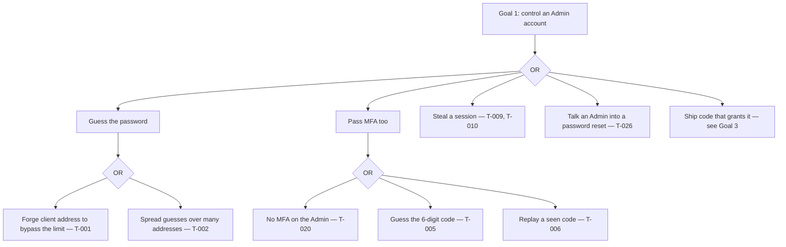
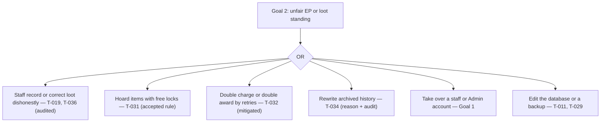
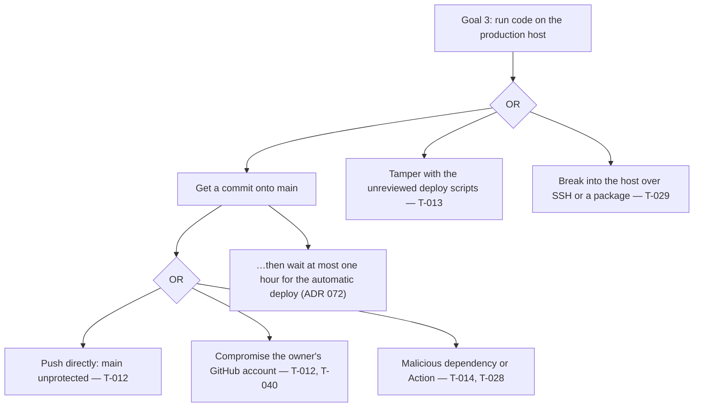
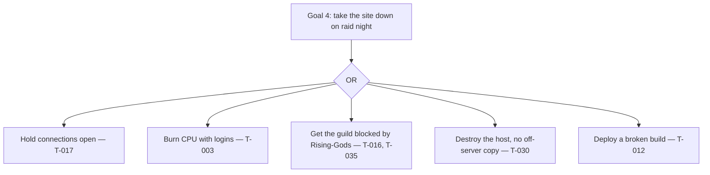
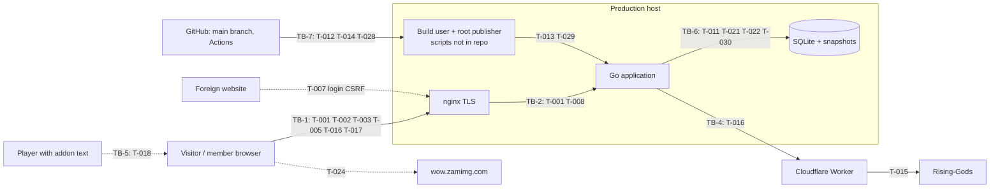
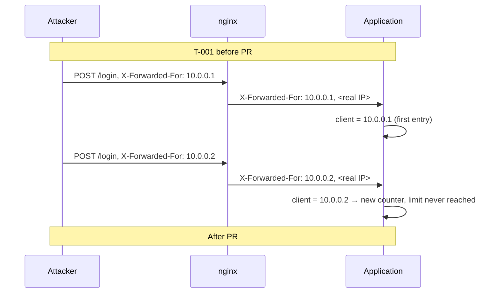

# Threat Model — raid-website

This file owns threats, their evidence, gaps, and coverage. Controls are owned by `SECURITY.md`
(`SC-*`, `OD-*`), behaviour by `REQUIREMENTS.md`, components and trust boundaries by
`ARCHITECTURE.md` (`TB-*`). Threats have stable IDs `T-nnn` that are never reused. It models the
specification and code of v1.0.27 and the `deploy/` templates as of 2026-10-22.

## Method

The Manicode bootstrap (step 08) runs a private threat-modeling pipeline
(`aegis/security-utilities-knowledge/content/pipelines/threat-modeling`, stages 00–11) that is not
available to this project. Instead, every technique in the OWASP Threat Modeling Cheat Sheet
("Choosing a threat modeling technique") was applied, each from its own angle, and the results
were merged into one register:

| Technique | Angle | Section |
| --- | --- | --- |
| DFD | System model: entities, processes, stores, flows, boundaries | [DFD elements](#dfd-elements) |
| STRIDE | Technical threats per DFD element | [STRIDE per element](#stride-per-element) |
| Attack trees | Paths to the four highest-value attacker goals | [Attack trees](#attack-trees) |
| Misuse and abuse cases | Valid workflows used out of order, repeatedly, concurrently, or for unintended results | [Misuse and abuse cases](#misuse-and-abuse-cases) |
| LINDDUN | Privacy harms STRIDE does not cover | [LINDDUN](#linddun) |
| PASTA | Business objectives → technical threats → business impact | [PASTA](#pasta) |
| OCTAVE | Organisation-wide risk to critical assets: people and process | [OCTAVE](#octave) |
| VAST | Split into application and operational threat models | `VAST` column in [Coverage](#coverage) |
| Brainstorming | Shared vocabulary with the owner | [Brainstorming](#brainstorming) |
| Shostack responses | Mitigate, Eliminate, Transfer, or Accept per threat | `Response` column in [Coverage](#coverage) |
| Review and validation | The cheat sheet's stakeholder checklist | [Review and validation](#review-and-validation) |

The Manicode stages map onto these: 00 [Scope](#scope), 01 [Assets](#assets), 02
[Actors](#actors-and-entry-points), 03 DFD, 04 STRIDE, 05 abuse cases, 06
[Implementation evidence](#implementation-evidence), 07 LINDDUN, 08 the single register,
09–10 [Diagrams](#diagrams), 11 this file.

Rules: missing information is an evidence gap, not a vulnerability. No numeric risk scores are
assigned; PASTA impact is described in words. Each threat has a **status**: `MITIGATED` (controls
exist and are verified in code), `PARTIAL` (some controls exist or a fix is pending), `OPEN` (a
rule exists or is planned but is not built), `DECISION` (needs an owner decision, linked `OD-*` or
`OQ-*`), or `ACCEPTED` (the owner accepted it).

## Scope

- **In scope:** the Go application and its embedded SPA, the SQLite database and snapshots, the
  production host as described by `deploy/`, the Cloudflare Worker, GitHub Actions, the source
  repository, and the copy-and-paste exchange with the two addons.
- **Out of scope:** the WoW client and the addons' own code (`wow-addons` repository),
  Rising-Gods' own security, Cloudflare and Hetzner platform security, and players' own devices.
- **Assumptions:** one guild of tens of players; staff (RAIDASSISTENT and higher) are guild
  officers trusted to record loot honestly; the owner is the only maintainer.

## Assets

| Asset | Why it matters |
| --- | --- |
| A-1 Accounts and credentials | Password hashes, TOTP secrets, recovery codes, WebAuthn credentials, sessions; control everything else |
| A-2 Enhance Point ledger and loot history | The guild's fairness record; the core business value |
| A-3 Audit log | The record of who changed what |
| A-4 Personal data | Login names, client addresses in login attempts, Rising-Gods profile links, audit snapshots (GDPR, FR-30) |
| A-5 Production deployment path | `main` branch, build account, root-owned publisher, systemd units |
| A-6 Secrets | `ADMIN_PASSWORD`, `RISING_GODS_PROXY_TOKEN`, Cloudflare API token, privacy contact, planned TOTP key |
| A-7 Availability | The site during raid nights; the Rising-Gods relationship (upstream blocking) |
| A-8 Backups | Snapshots on the host and the planned off-server copy |

## Actors and entry points

| Actor | Entry points |
| --- | --- |
| Visitor | Public reads (FR-1.2), login, MFA, registration request and redemption, Rising-Gods search |
| GUEST / MEMBER | All authenticated reads, self-service writes (signups, absences, wishlist, locks, votes, own security settings) |
| Staff (RAIDASSISTENT, RAIDLEADER) | Raid, roster, loot, imports, polls, Shadowmourne, recruitment |
| ADMIN | Accounts, roles, merges, configuration, audit log, registration codes |
| Person pasting addon text | Roster and loot import (through staff) |
| Rising-Gods / Worker | Responses to outbound lookups |
| Repository contributor or compromised GitHub account | Pushes to `main`, workflow runs, Actions secrets |
| Host-level attacker | SSH, OS packages, database file, snapshots |

## Data flow

The components, flows, and trust boundaries are those in `ARCHITECTURE.md` ("Main data flows",
"Trust boundaries"). The diagram below adds the threats that cross each boundary.

## Threat register

### Authentication and sessions (TB-1, TB-2, TB-3)

**T-001 — Password guessing with a forged client address**
- **Category:** Spoofing. **Actor:** visitor. **Asset:** A-1.
- **Scenario:** The login limit counts failures per username and client address. Behind nginx the
  application took the first `X-Forwarded-For` entry, which the client writes, so rotating it gave
  unlimited guesses.
- **Evidence:** `clientAddress` in `internal/httpapi/v1/security.go`; `deploy/nginx/raid-website.conf`
  (`$proxy_add_x_forwarded_for`); `TRUST_PROXY_HEADERS=true` in production.
- **Status:** PARTIAL — fixed in PR #44, not yet merged or deployed.
- **Controls:** SC-006, SC-008.

**T-002 — Distributed guessing against one account**
- **Category:** Spoofing. **Actor:** visitor with many addresses. **Asset:** A-1.
- **Scenario:** Even with T-001 fixed, the limit is per username *and* address; an attacker with
  many addresses gets 5 tries per address against the same account.
- **Evidence:** `auth.StartLogin` counts `CountFailedLoginAttempts(username, clientIP, …)`; no
  per-account limit. Passwords are at least 12 characters (SC-005), which reduces the impact.
- **Status:** DECISION — OD-010.
- **Controls:** SC-008, SC-043.

**T-003 — Login CPU exhaustion**
- **Category:** Denial of service. **Actor:** visitor. **Asset:** A-7.
- **Scenario:** Each login with an existing username runs bcrypt; after SC-009, unknown usernames
  will too. Rotating usernames from one address is not limited, so one client can keep the CPU busy.
- **Evidence:** limit keyed by username and address only; bcrypt `DefaultCost`.
- **Status:** DECISION — OD-010.
- **Controls:** SC-009, SC-043.

**T-004 — Username probing by response time**
- **Category:** Information disclosure. **Actor:** visitor. **Asset:** A-4.
- **Evidence:** unknown usernames return before any bcrypt comparison.
- **Status:** OPEN. **Controls:** SC-009.

**T-005 — MFA code guessing**
- **Category:** Spoofing. **Actor:** visitor who knows a password. **Asset:** A-1.
- **Evidence:** `VerifyMFAChallenge` has no failure counter; a challenge lives 5 minutes.
- **Status:** OPEN. **Controls:** SC-010, SC-011.

**T-006 — TOTP code replay**
- **Category:** Spoofing. **Actor:** someone who saw a code (shoulder surfing, phishing relay).
- **Evidence:** no last-used time step is stored.
- **Status:** OPEN. **Controls:** SC-012.

**T-007 — Login CSRF and session swapping**
- **Category:** Spoofing. **Actor:** malicious website. **Asset:** A-1, A-2.
- **Scenario:** A foreign page logs the victim's browser into the attacker's account, or posts a
  change through a request without `Origin` and `Sec-Fetch-Site`.
- **Evidence:** `csrfProtection` skips requests without both headers.
- **Status:** OPEN. **Controls:** SC-019 (OD-009 decided).

**T-008 — WebAuthn origin from forwarded headers**
- **Category:** Spoofing. **Asset:** A-1.
- **Evidence:** without `PUBLIC_ORIGIN`, `webAuthnRelyingParty` trusts `X-Forwarded-Host`, which
  nginx passes through unchanged; production does not require `PUBLIC_ORIGIN`.
- **Status:** OPEN. **Controls:** SC-007.

**T-009 — Session theft through script injection**
- **Category:** Spoofing, Elevation. **Actor:** user who stores crafted text (names, notes, poll
  answers) or pasted addon lines.
- **Evidence:** React text rendering only, no `dangerouslySetInnerHTML`; CSP `script-src 'self'`;
  session cookie `HttpOnly`. `style-src 'unsafe-inline'` remains (styles only, no script).
- **Status:** MITIGATED. **Controls:** SC-016, SC-022, SC-024.

**T-010 — A stolen session stays valid**
- **Category:** Spoofing. **Asset:** A-1.
- **Scenario:** A session left on a shared computer or copied cookie works for 30 days, and a
  password change does not end it.
- **Status:** OPEN. **Controls:** SC-017, SC-018.

**T-020 — Admin account takeover**
- **Category:** Elevation of privilege. **Actor:** anyone who gets an Admin password. **Asset:** all.
- **Scenario:** An Admin can change roles, credentials, merges, and configuration. MFA is optional
  for every account, Admin included.
- **Evidence:** FR-3.1 (MFA optional for each account); no role-based MFA requirement.
- **Status:** DECISION — OD-012. **Controls:** SC-040.

**T-026 — Account recovery by social engineering**
- **Category:** Spoofing. **Actor:** someone pretending to be a member. **Asset:** A-1.
- **Scenario:** There is no self-service reset; an Admin sets a new password on request. No step
  verifies that the requester owns the account.
- **Evidence:** FR-5.1; no recovery workflow in the spec.
- **Status:** DECISION — OD-014. **Controls:** SC-042.

### Registration and external lookups (TB-4)

**T-016 — Rising-Gods lookup amplification**
- **Category:** Denial of service. **Actor:** visitor. **Asset:** A-7.
- **Scenario:** Each new public search costs Rising-Gods 3–5 seconds; a flood can get the guild
  blocked upstream.
- **Status:** OPEN. **Controls:** SC-027, SC-028.

**T-025 — The wrong person becomes MEMBER**
- **Category:** Spoofing. **Actor:** a non-member with an Alliance level-80 Rising-Gods character.
- **Scenario:** Since OQ-3, redeeming a new-account code grants MEMBER. The code reaches only the
  in-game character of the request, which proves ownership of that character but not guild
  membership; the Admin decides whether to issue a code.
- **Status:** ACCEPTED — the Admin's decision to issue a code is the guild-membership check
  (FR-4.3).
- **Controls:** SC-013.

**T-015 — Misuse of the Rising-Gods Worker**
- **Category:** Spoofing, Denial of service. **Asset:** A-6, A-7.
- **Evidence:** GET `/` only, fixed origin, shared token header; the token comparison in the
  Worker is not constant-time (remote timing over Cloudflare is not practical).
- **Status:** MITIGATED. **Controls:** SC-029.

### Raid data and addon exchange (TB-3, TB-5)

**T-018 — Crafted addon export text**
- **Category:** Tampering. **Actor:** person who hands staff a manipulated export.
- **Evidence:** preview without writes, ordinary validated loot and roster paths, raid-scoped
  idempotency keys, 1 MiB body limit, separator escaping on export.
- **Status:** MITIGATED. **Controls:** SC-020, SC-022; FR-20.3, FR-20.6.

**T-019 — Staff manipulate EP or loot**
- **Category:** Tampering, Repudiation. **Actor:** staff. **Asset:** A-2.
- **Evidence:** every write is audited in the same transaction; the EP ledger is append-only;
  only Admins read the audit log.
- **Status:** ACCEPTED — staff are trusted by design; the audit log makes changes traceable.
- **Controls:** SC-031; FR-16.1, FR-26.

**T-027 — Injection and framing**
- **Category:** Tampering. **Evidence:** parameterised SQL, strict JSON decoding,
  `frame-ancestors 'none'` and `X-Frame-Options: DENY`.
- **Status:** MITIGATED. **Controls:** SC-020, SC-021, SC-024.

### Logging and privacy (TB-6)

**T-011 — Database or backup copy leaks secrets and personal data**
- **Category:** Information disclosure. **Actor:** whoever obtains a database file or snapshot.
- **Evidence:** TOTP secrets are plaintext; host snapshots are compressed, not encrypted, in a
  root-only directory; the off-server copy is not set up.
- **Status:** OPEN (SC-014) and DECISION (OD-007) for the off-server copy.
- **Controls:** SC-014, SC-034, SC-035.

**T-021 — Security events leave no trace**
- **Category:** Repudiation. **Asset:** A-1.
- **Scenario:** Failed logins, lockouts, MFA failures, and rejected CSRF requests are not logged
  as events; the journal shows only method, path, and status. An attack or a takeover cannot be
  noticed or reconstructed.
- **Evidence:** no log calls in `internal/auth`; FR-26.4 excludes logins from the audit log.
- **Status:** DECISION — OD-013. **Controls:** SC-041.

**T-022 — Personal data in operational tables kept forever**
- **Category:** Information disclosure (privacy: data retention). **Asset:** A-4.
- **Evidence:** `login_attempts` stores username and client address and is never pruned;
  expired `sessions` and MFA challenges are never deleted (`auth.Repo.DeleteExpired` exists but is
  never called).
- **Status:** OPEN. **Controls:** SC-038.

**T-023 — Public data about players**
- **Category:** Information disclosure (privacy: identifiability). **Asset:** A-4.
- **Scenario:** Visitors see player names, guild ranks, raid attendance with character names, and
  loot totals per player.
- **Status:** ACCEPTED — owner decisions OQ-6 and FR-1.2/FR-1.3; the privacy page must describe it
  (FR-30.1).

**T-024 — Third-party image host learns visitor addresses**
- **Category:** Information disclosure (privacy). **Evidence:** class icons load from
  `wow.zamimg.com`.
- **Status:** OPEN (decided DQ-2). **Controls:** SC-024.

### Platform, build, and deployment (TB-7)

**T-012 — Unreviewed code reaches production**
- **Category:** Tampering, Elevation of privilege. **Actor:** anyone with push access, a
  compromised GitHub account or token, or a mistaken push. **Asset:** A-5, then all.
- **Scenario:** The host deploys the newest `main` every hour (ADR 072). ADR 071 and 072 require a
  protected branch and review, but `main` is not protected: the repository ruleset "Protect"
  (deletion and force-push rules only) is **disabled**, and no pull request or status check is
  required. The repository is public.
- **Evidence:** GitHub API on 2026-10-22: `branches/main` → `protected: false`; ruleset
  enforcement `disabled`.
- **Status:** DECISION — OD-011. **Controls:** SC-036, SC-039.

**T-013 — Root-run deployment scripts are not under review**
- **Category:** Tampering, Elevation of privilege. **Asset:** A-5.
- **Scenario:** `deploy/README.md` installs `raid-website-publish` (runs as root), `-update`,
  `-backup`, and `-configure-ufw` from `deploy/bin/`, but `.gitignore` contains `bin/`, so the
  folder is not in the repository. The publisher's validation of the build (ADR 071, ADR 072) and
  the firewall rules cannot be reviewed or reproduced.
- **Evidence:** `.gitignore` line `bin/`; `git ls-tree` of `main` has no `deploy/bin`.
- **Status:** OPEN. **Controls:** SC-037.

**T-014 — Compromised GitHub Action steals the Cloudflare token**
- **Category:** Tampering, Information disclosure. **Asset:** A-6.
- **Evidence:** actions pinned by tag; `cloudflare/wrangler-action` receives `CLOUDFLARE_API_TOKEN`.
- **Status:** OPEN (decided OD-006). **Controls:** SC-036.

**T-028 — Vulnerable dependency ships unnoticed**
- **Category:** Tampering, Elevation of privilege. **Asset:** all.
- **Evidence:** CI runs build, lint and tests but no vulnerability scan (`govulncheck`,
  `npm audit`); Dependabot is decided but not configured.
- **Status:** DECISION — OD-011. **Controls:** SC-036, SC-039.

**T-017 — Slow requests exhaust the server**
- **Category:** Denial of service. **Evidence:** `http.ListenAndServe` without timeouts.
- **Status:** OPEN. **Controls:** SC-026.

**T-029 — Host compromise**
- **Category:** Elevation of privilege. **Evidence:** key-only SSH, unattended upgrades with
  scheduled reboots, systemd sandboxing, unprivileged service and build users; firewall rules live
  in an unreviewed script (T-013).
- **Status:** PARTIAL. **Controls:** SC-025, SC-035, SC-037.

**T-030 — Loss of the host loses all data**
- **Category:** Denial of service (availability of A-2, A-3). **Evidence:** all snapshots are on
  the same host; the off-server copy is deferred.
- **Status:** DECISION — OD-007. **Controls:** SC-034; NFR-2.3.

### Business-rule abuse (misuse cases)

**T-031 — One player locks every valuable item**
- **Category:** Tampering (fairness). **Actor:** MEMBER with 150 or more EP. **Asset:** A-2.
- **Scenario:** Locks cost nothing and a player may hold several (FR-17.2, FR-17.3), so a rich
  player can lock many items of one raid; competing locks are then rejected.
- **Status:** ACCEPTED — owner rule ADR 012 / ADR 017.

**T-032 — Concurrent or repeated writes charge or award twice**
- **Category:** Tampering. **Actor:** staff (double click, retry, two staff importing at once).
- **Evidence:** `request_id` idempotency for enhanced awards (FR-14.6), raid-scoped import keys
  (FR-20.7), quick-add receipts (FR-13.6), idempotent archive (FR-10.9), one SQLite connection.
- **Status:** MITIGATED.

**T-033 — Acting after a deadline**
- **Category:** Tampering. **Actor:** MEMBER changing a signup or absence after the raid started.
- **Evidence:** deadlines use the server's UTC clock on every request (FR-12.2, FR-12.9).
- **Status:** MITIGATED.

**T-034 — Quietly rewriting archived history**
- **Category:** Tampering, Repudiation. **Actor:** staff.
- **Evidence:** archived corrections need a reason, keep finalisation fixed, and are audited
  (FR-13.12, FR-26.5).
- **Status:** MITIGATED.

**T-035 — Registration request flooding**
- **Category:** Denial of service. **Actor:** visitor. **Asset:** Admin attention, A-7.
- **Evidence:** one open request per Rising-Gods profile (FR-4.2); no rate limit yet.
- **Status:** OPEN. **Controls:** SC-028.

**T-036 — Using the EP floor to keep points**
- **Category:** Tampering. **Actor:** staff together with a player.
- **Scenario:** A correction that would take a player below 0 forgives the rest (FR-16.6), so a
  spend-then-correct sequence can leave points that a normal history would not.
- **Evidence:** staff see a warning and the forgiven amount is audited (FR-16.8).
- **Status:** ACCEPTED — owner decision of 2026-10-22; staff are trusted (T-019).

### Privacy (LINDDUN)

**T-037 — Members are not told what is stored (Unawareness)**
- **Category:** LINDDUN Unawareness. **Asset:** A-4.
- **Evidence:** the privacy page is specified (FR-30.1) but not built.
- **Status:** OPEN.

**T-038 — Members cannot see or get their own data (Unintervenability)**
- **Category:** LINDDUN Unintervenability. **Asset:** A-4.
- **Scenario:** A member can ask for anonymisation (FR-30.5) but has no way to see or export the
  data stored about them; GDPR gives a right of access and portability.
- **Evidence:** no export or "my data" view in the spec or the code.
- **Status:** DECISION — OQ-15.

**T-039 — Retention conflicts with storage limitation (Non-compliance)**
- **Category:** LINDDUN Non-compliance. **Asset:** A-3, A-4.
- **Scenario:** The audit log keeps personal data without a time limit (FR-30.4), and no legal
  review of the privacy setup has happened.
- **Status:** ACCEPTED — owner decision OQ-12; a legal review stays recommended.

### Organisation (OCTAVE)

**T-040 — Everything depends on one person**
- **Category:** Availability, Elevation (people and process). **Asset:** A-5, A-6, A-8.
- **Scenario:** The owner is the only maintainer and holds the GitHub, Cloudflare, and host access
  and the planned backup and TOTP keys. If that person is unavailable or their accounts are
  compromised, nobody can restore, rotate, or even notice.
- **Status:** DECISION — OD-015.

**T-041 — No plan for a suspected compromise**
- **Category:** Repudiation, Elevation (process). **Asset:** all.
- **Scenario:** There is no written incident procedure, no Admin action to end every session at
  once, and no documented way to rotate `ADMIN_PASSWORD`, the Worker token, the Cloudflare token,
  or the planned TOTP key.
- **Evidence:** only account merge revokes sessions (`accountmerge.RevokeSourceAuth`); no
  rotation steps in `deploy/README.md`.
- **Status:** DECISION — OD-015.

## Implementation evidence

Unlike the Manicode playbook's empty repository, an implementation exists. It was reviewed for the
threats above: route registration and guards, middleware (`internal/httpapi/middleware.go`),
`internal/httpapi/v1/security.go`, `internal/auth`, `internal/registration/rising_gods.go`,
`internal/addonsync` and `internal/wishlist` exporters, `internal/config`, `cmd/server`,
`workers/`, `.github/workflows/`, `deploy/` templates, and the repository settings through the
GitHub API. Not reviewed: every domain service line by line, the frontend beyond rendering and
API usage, and the installed state of the production host.

## Conflicts and evidence gaps

- **Conflict:** ADR 071 and ADR 072 require a protected `main`; GitHub shows it unprotected (T-012).
- **Conflict:** `deploy/README.md` installs scripts that are not in the repository (T-013).
- **Gap:** the installed production host (units, firewall, file permissions) was not inspected;
  findings rely on the templates.
- **Gap:** who has push access to the repository could not be read (the API path is not available
  to this review).
- **Gap:** no incident procedure or secret-rotation steps exist (T-041).
- **Gap:** the Hetzner provider snapshot policy mentioned in `deploy/README.md` is not documented
  as active (OD-007).

## DFD elements

| Kind | Elements |
| --- | --- |
| External entities | Visitor and member browsers; foreign websites; players with addon text; Rising-Gods; Cloudflare Worker; GitHub (repository, Actions); `wow.zamimg.com` (until DQ-2) |
| Processes | nginx; Go application (middleware, handlers, domain services); build user (`raiddeploy`); root publisher; backup and verify jobs; Worker |
| Data stores | SQLite database; host snapshots; off-server copy (planned); environment files (`/etc/raid-website*.env`); GitHub secrets; Cloudflare secrets; browser cookies and `localStorage` |
| Flows | The five flows in `ARCHITECTURE.md` "Main data flows", plus deploy (GitHub → build → publish) and backup (database → snapshot → off-server) |
| Boundaries | TB-1 to TB-7 in `ARCHITECTURE.md` |

## STRIDE per element

Threat IDs per element and category; "—" means the category was checked and nothing material was
found.

| Element | S | T | R | I | D | E |
| --- | --- | --- | --- | --- | --- | --- |
| Browser → nginx (TB-1) | T-001, T-002, T-007 | — | — | — | T-003, T-016, T-017 | — |
| nginx → application (TB-2) | T-001, T-008 | — | — | — | T-017 | — |
| Authentication (`auth`) | T-002, T-005, T-006, T-010, T-026 | — | T-021 | T-004 | T-003 | T-020 |
| Domain services and API | — | T-018, T-027, T-031 to T-034, T-036 | T-019 | T-023 | T-035 | T-009 |
| Rising-Gods / Worker (TB-4) | T-015 | — | — | — | T-016 | — |
| Addon text (TB-5) | — | T-018 | — | — | — | — |
| SQLite and snapshots (TB-6) | — | — | T-021 | T-011, T-022 | T-030 | — |
| Build and deploy (TB-7) | — | T-012, T-013, T-014, T-028 | — | T-014 | — | T-012, T-013, T-029 |
| Third-party image host | — | — | — | T-024 | — | — |
| Organisation | — | — | T-041 | — | T-040 | T-040, T-041 |

## Attack trees

OR = any child is enough; AND = all children are needed.

## Misuse and abuse cases

Each valid workflow was checked for use out of order, repeatedly, concurrently, and for an
unintended result. Findings are T-031 to T-036; checked without a new finding:

| Workflow | Out of order | Repeated | Concurrent | Unintended result |
| --- | --- | --- | --- | --- |
| Archive raid | Rejected without series, start, or full roster (FR-10.7) | Idempotent (FR-10.9) | Serialized writes | — |
| Enhanced loot | Needs roster recipient (FR-14.3) | `request_id` (FR-14.6) | One connection | EP floor: T-036 |
| Addon import | Preview before apply (FR-20.3) | Raid-scoped keys (FR-20.7) | Same | Moves no awards (FR-20.11) |
| Item lock | Rejected on closed raids (FR-17.5) | Competing lock rejected (FR-17.3) | Atomic check | Hoarding: T-031 |
| Signup / absence | Server deadline (FR-12.2, FR-12.9) | Edits replace the choice | — | — |
| Registration | Code only after Admin action (FR-4.3) | One open request per profile (FR-4.2) | Insert trigger | Flooding: T-035 |
| Character claim | Code delivered in game | Single-use codes (SC-013) | — | — |
| Merges, transfers | Admin only, reason | Conflicts rejected (FR-5.6, FR-6.9, FR-6.11) | Transaction | — |
| Poll vote | Closed polls rejected (FR-24.4) | One vote per player (FR-24.3) | Upsert | — |

## LINDDUN

| Category | Finding |
| --- | --- |
| Linking | Login ↔ player ↔ Rising-Gods profile is linkable only by Admins (FR-1.3, FR-5.2); public data links characters to raids (T-023). |
| Identifying | Character names are public in game and on the site (T-023, accepted); anonymisation keeps them (FR-30.3). |
| Non-repudiation | The audit log permanently attributes every change to a person — useful for integrity, a privacy cost (T-039). |
| Detecting | Public attendance reveals who raided when (T-023); third-party image requests reveal visits (T-024). |
| Data disclosure | Plaintext TOTP secrets and unencrypted snapshots (T-011); never-pruned login attempts with addresses (T-022). |
| Unawareness | No privacy notice yet (T-037). |
| Unintervenability | No access or export for members (T-038); anonymisation only through an Admin (FR-30.5). |
| Non-compliance | Unlimited audit retention, no legal review (T-039). |

## PASTA

1. **Business objectives:** a fair, trusted EP and loot record (A-2); members can sign up and see
   standings on raid nights (A-7); low effort for one volunteer maintainer; GDPR-respectful
   handling of members' data (A-4).
2. **Technical scope:** see [Scope](#scope) and `ARCHITECTURE.md`.
3. **Decomposition:** [DFD elements](#dfd-elements).
4. **Threat analysis:** the attacker goals in [Attack trees](#attack-trees).
5. **Weakness analysis:** the `not compliant` evidence in `SECURITY.md` and the gaps in
   [Conflicts and evidence gaps](#conflicts-and-evidence-gaps).
6. **Attack modeling:** [Attack trees](#attack-trees) and the T-001 sequence diagram.
7. **Business impact (in words, no scores):**
   - Losing the fairness record or trust in it (Goal 2, T-012, T-030) would undermine the guild's
     loot system itself; this is the most damaging outcome.
   - An Admin takeover (Goal 1) gives full control over accounts and history.
   - Code on production (Goal 3) gives all of the above plus the secrets; today the shortest path is
     T-012.
   - Raid-night outages (Goal 4) are annoying but recoverable if backups exist off-server.
   - Privacy failures (T-022, T-037 to T-039) are compliance and trust problems rather than
     operational ones.

## OCTAVE

- **Critical assets:** A-2 (fairness record), A-5 (deployment path), A-1 (Admin accounts).
- **Threat profiles (people and process):** single maintainer and key holder (T-040); no incident
  procedure, no global session revocation, no secret rotation steps (T-041); account recovery
  without identity check (T-026); unprotected `main` (T-012).
- **Current practices that work:** unattended upgrades and scheduled reboots, sandboxed services,
  verified snapshots, ADRs and audit log as a record of decisions and changes.
- **Strategy:** protect the deployment path first (SC-039, SC-037), then Admin accounts (SC-040,
  SC-043), then recovery and continuity (OD-007, OD-015).

## Brainstorming

The owner question passes of 2026-10-22 (OQ-*, DQ-*, AQ-*, OD-*) served as the brainstorming
round: each was explained in plain language and answered by the owner. The threat model reuses
that shared vocabulary ("wristband" sessions, "secret handshake" CSRF, "spare key" backups).

## Review and validation

The cheat sheet's stakeholder checks:

| Check | Result |
| --- | --- |
| Does the DFD match the system? | Yes for code and templates; the installed host was not inspected (gap). |
| Are all threats identified? | All seven techniques applied; per-domain service code was not read line by line (gap). |
| Does every threat have an agreed response? | Yes — `Response` column; DECISION items wait for the owner. |
| Are mitigations testable and measurable? | Yes — every SC rule has a **Verification** field. |
| Is the model kept up to date? | `AGENTS.md` lists this file as the owner of threats; new features add or update T entries. |

## Coverage

### Threats to controls

| Threat | Status | Response | VAST | Controls and decisions |
| --- | --- | --- | --- | --- |
| T-001 | PARTIAL | Mitigate | App | SC-006, SC-008 |
| T-002 | DECISION | Mitigate | App | SC-008, SC-043, OD-010 |
| T-003 | DECISION | Mitigate | App | SC-009, SC-043, OD-010 |
| T-004 | OPEN | Mitigate | App | SC-009 |
| T-005 | OPEN | Mitigate | App | SC-010, SC-011 |
| T-006 | OPEN | Mitigate | App | SC-012 |
| T-007 | OPEN | Mitigate | App | SC-019 |
| T-008 | OPEN | Mitigate | App | SC-007 |
| T-009 | MITIGATED | Mitigate | App | SC-016, SC-022, SC-024 |
| T-010 | OPEN | Mitigate | App | SC-017, SC-018 |
| T-011 | OPEN / DECISION | Mitigate | App + Ops | SC-014, SC-034, SC-035, OD-007 |
| T-012 | DECISION | Mitigate | Ops | SC-036, SC-039, OD-011 |
| T-013 | OPEN | Mitigate | Ops | SC-037 |
| T-014 | OPEN | Mitigate | Ops | SC-036 |
| T-015 | MITIGATED | Mitigate | Ops | SC-029 |
| T-016 | OPEN | Mitigate | App | SC-027, SC-028 |
| T-017 | OPEN | Mitigate | App | SC-026 |
| T-018 | MITIGATED | Mitigate | App | SC-020, SC-022 |
| T-019 | ACCEPTED | Accept | App | SC-031 |
| T-020 | DECISION | Mitigate | App | SC-040, OD-012 |
| T-021 | DECISION | Mitigate | App + Ops | SC-041, OD-013 |
| T-022 | OPEN | Eliminate | App | SC-038 |
| T-023 | ACCEPTED | Accept | App | SC-004 |
| T-024 | OPEN | Eliminate | App | SC-024 |
| T-025 | ACCEPTED | Accept | App | SC-013 |
| T-026 | DECISION | Mitigate | Ops | SC-042, OD-014 |
| T-027 | MITIGATED | Mitigate | App | SC-020, SC-021, SC-024 |
| T-028 | DECISION | Mitigate | Ops | SC-036, SC-039, OD-011 |
| T-029 | PARTIAL | Mitigate | Ops | SC-025, SC-035, SC-037 |
| T-030 | DECISION | Transfer or Mitigate | Ops | SC-034, OD-007 |
| T-031 | ACCEPTED | Accept | App | FR-17.2, FR-17.3 |
| T-032 | MITIGATED | Mitigate | App | FR-10.9, FR-13.6, FR-14.6, FR-20.7 |
| T-033 | MITIGATED | Mitigate | App | FR-12.2, FR-12.9 |
| T-034 | MITIGATED | Mitigate | App | FR-13.12, FR-26.5 |
| T-035 | OPEN | Mitigate | App | SC-028 |
| T-036 | ACCEPTED | Accept | App | FR-16.6, FR-16.8 |
| T-037 | OPEN | Mitigate | App | FR-30.1 |
| T-038 | DECISION | Mitigate | App | OQ-15 |
| T-039 | ACCEPTED | Accept | Ops | FR-30.4 |
| T-040 | DECISION | Mitigate | Ops | OD-015 |
| T-041 | DECISION | Mitigate | Ops | SC-044, OD-015 |

### Trust boundaries to threats

| Boundary | Threats |
| --- | --- |
| TB-1 Internet → proxy | T-001, T-003, T-016, T-017 |
| TB-2 Proxy → application | T-001, T-008 |
| TB-3 Browser → API | T-002 to T-007, T-009, T-010, T-019, T-020, T-023, T-026, T-027, T-031 to T-036, T-038 |
| TB-4 Application → Rising-Gods | T-015, T-016, T-025 |
| TB-5 Addon text → application | T-018 |
| TB-6 Application → database and snapshots | T-011, T-021, T-022, T-030 |
| TB-7 Build and deploy | T-012, T-013, T-014, T-028, T-029 |
| Third-party browser requests | T-024 |
| Organisation (no technical boundary) | T-037, T-039, T-040, T-041 |

### Rules without a threat

SC-001, SC-002, SC-003, SC-005, SC-015, SC-023, SC-030, SC-032, SC-033 are baseline controls; they are not tied to
a single threat above and stay in force.

## Diagrams

