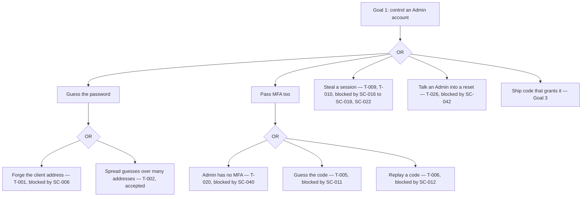
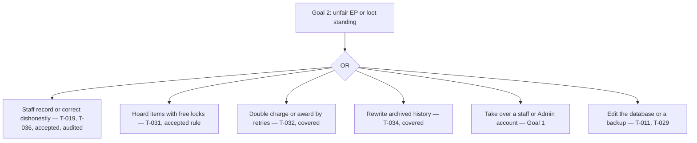
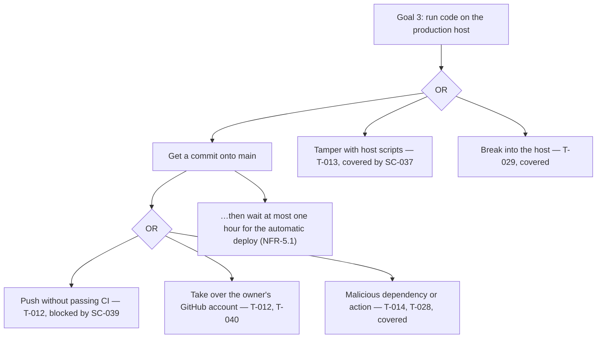
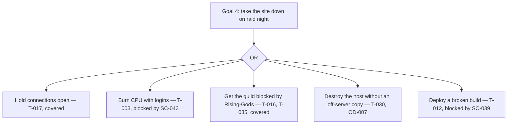
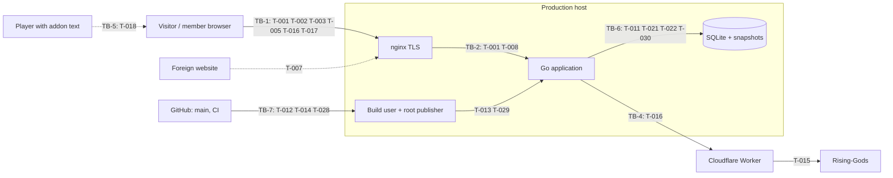

# Threat Model — raid-website

This file owns the threats against the **specification**: what `REQUIREMENTS.md`, `DESIGN.md`,
`ARCHITECTURE.md`, and `SECURITY.md` allow, assume, or leave out. Controls are owned by
`SECURITY.md` (`SC-*`, `OD-*`), behaviour by `REQUIREMENTS.md`, components and trust boundaries by
`ARCHITECTURE.md` (`TB-*`). Threats have stable IDs `T-nnn` that are never reused. Whether the code
follows the specification is not a threat-model question; it is tracked in the **Evidence** field
of each `SC-*` rule and in the backlog (see the [appendix](#appendix-implementation-observations)).

## Method

The Manicode bootstrap (step 08) runs a private threat-modeling pipeline
(`aegis/security-utilities-knowledge/content/pipelines/threat-modeling`, stages 00–11) that is not
available to this project. Instead, every technique in the OWASP Threat Modeling Cheat Sheet
("Choosing a threat modeling technique") was applied to the specification, each from its own
angle, and the results were merged into one register:

| Technique | Angle | Section |
| --- | --- | --- |
| DFD | System model from `ARCHITECTURE.md`: entities, processes, stores, flows, boundaries | [DFD elements](#dfd-elements) |
| STRIDE | Technical threats per DFD element | [STRIDE per element](#stride-per-element) |
| Attack trees | Paths to the four highest-value attacker goals | [Attack trees](#attack-trees) |
| Misuse and abuse cases | Specified workflows used out of order, repeatedly, concurrently, or for unintended results | [Misuse and abuse cases](#misuse-and-abuse-cases) |
| LINDDUN | Privacy harms STRIDE does not cover | [LINDDUN](#linddun) |
| PASTA | Business objectives → threats → business impact | [PASTA](#pasta) |
| OCTAVE | Organisation-wide risk to critical assets: people and process | [OCTAVE](#octave) |
| VAST | Split into application and operational threat models | `VAST` column in [Coverage](#coverage) |
| Brainstorming | Shared vocabulary with the owner | [Brainstorming](#brainstorming) |
| Shostack responses | Mitigate, Eliminate, Transfer, or Accept per threat | `Response` column in [Coverage](#coverage) |
| Review and validation | The cheat sheet's stakeholder checklist | [Review and validation](#review-and-validation) |

The Manicode stages map onto these: 00 [Scope](#scope), 01 [Assets](#assets), 02
[Actors](#actors-and-entry-points), 03 DFD, 04 STRIDE, 05 abuse cases, 06
[Implementation](#implementation), 07 LINDDUN, 08 the single register, 09–10
[Diagrams](#diagrams), 11 this file.

Rules: the only evidence is the specification (and the ADRs it cites). Missing information is an
evidence gap, not a vulnerability. No numeric risk scores are assigned; PASTA impact is described
in words. Each threat has a **status** that describes the specification:

- `COVERED` — an `ACTIVE` spec rule addresses the threat.
- `PARTLY COVERED` — a spec rule exists but is `BLOCKED` or `DEFERRED`, or covers only part.
- `GAP` — the specification has no control; a decision is needed (linked `OD-*` or `OQ-*`).
- `ACCEPTED` — the owner accepted the threat in the specification.

## Scope

- **In scope:** everything the four spec files describe: the application and its API, the web
  client, the database and snapshots, the production host and deployment path as specified in
  `ARCHITECTURE.md` and `SECURITY.md`, the Rising-Gods Worker, CI, and the addon text exchange.
- **Out of scope:** the WoW client and the addons' own code, Rising-Gods' own security, Cloudflare,
  GitHub and hosting-provider platform security, players' own devices.
- **Assumptions (from the spec):** one guild of tens of players; staff (RAIDASSISTENT and higher)
  are trusted guild officers; the owner is the only maintainer; production deploys `main`
  automatically every hour (NFR-5.1, ADR 072).

## Assets

| Asset | Why it matters |
| --- | --- |
| A-1 Accounts and credentials | Password hashes, TOTP secrets, recovery codes, WebAuthn credentials, sessions (FR-2, FR-3) |
| A-2 Enhance Point ledger and loot history | The guild's fairness record (FR-14, FR-16) |
| A-3 Audit log | The record of who changed what (FR-26) |
| A-4 Personal data | Login names, client addresses, Rising-Gods profile links, audit snapshots (FR-30) |
| A-5 Production deployment path | `main`, CI, build account, root publisher (TB-7) |
| A-6 Secrets | Admin bootstrap password, Worker token, Cloudflare token, privacy contact, TOTP key (SC-033, SC-014) |
| A-7 Availability | The site on raid nights; the Rising-Gods relationship (FR-7) |
| A-8 Backups | Host snapshots and the off-server copy (NFR-2) |

## Actors and entry points

| Actor | Entry points (spec) |
| --- | --- |
| Visitor | Public reads (FR-1.2), login and MFA (FR-2, FR-3), registration (FR-4), Rising-Gods search (FR-7) |
| GUEST / MEMBER | Authenticated reads (FR-1.5), self-service writes (FR-12, FR-17, FR-19, FR-24, FR-2.7, FR-3) |
| Staff | Raid, roster, loot, imports, polls, Shadowmourne, recruitment (FR-10 to FR-24) |
| ADMIN | Accounts, roles, merges, configuration, audit log, codes (FR-1.8, FR-5, FR-6, FR-8) |
| Person handing over addon text | Imports through staff (FR-20) |
| Rising-Gods / Worker | Responses to lookups (TB-4) |
| Contributor or compromised GitHub account | Commits to `main`, CI (TB-7) |
| Host-level attacker | Host, database file, snapshots (TB-6) |

## Data flow

The components, flows, and trust boundaries are those in `ARCHITECTURE.md` ("Main data flows",
"Trust boundaries"). [DFD elements](#dfd-elements) lists them; the [diagram](#diagrams) adds the
threats that cross each boundary.

## Threat register

### Authentication and sessions (TB-1, TB-2, TB-3)

**T-001 — Forged client address behind the proxy**
- **Category:** Spoofing. **Actor:** visitor. **Asset:** A-1.
- **Scenario:** Per-client limits (FR-2.3, FR-7.6) need a client address. Behind a proxy, a header
  the client controls could be taken as that address, so every request looks new.
- **Spec basis:** SC-006 fixes the source to `X-Real-IP` set by nginx; TB-2.
- **Status:** COVERED. **Controls:** SC-006, SC-008.

**T-002 — Distributed guessing against one account**
- **Category:** Spoofing. **Actor:** visitor with many addresses. **Asset:** A-1.
- **Scenario:** FR-2.3 and SC-008 limit failures per username *and* address; with many addresses
  the same account can be guessed without limit. Only the password policy (SC-005) slows it.
- **Status:** ACCEPTED — owner decision OD-010: only a per-address limit (SC-043); distributed guessing against one account is slowed only by the password policy (SC-005).

**T-003 — Login CPU exhaustion**
- **Category:** Denial of service. **Actor:** visitor. **Asset:** A-7.
- **Scenario:** Every login runs bcrypt (SC-005), and SC-009 adds a dummy bcrypt for unknown
  names. The spec limits failures per username and address, not per address across usernames, so
  one client rotating usernames can keep the CPU busy.
- **Status:** COVERED — SC-043 (30 attempts per address in 15 minutes).

**T-004 — Username probing**
- **Category:** Information disclosure. **Asset:** A-4.
- **Spec basis:** SC-009 (same error and comparable time for every failure).
- **Status:** COVERED.

**T-005 — MFA code guessing**
- **Category:** Spoofing. **Actor:** visitor who knows a password. **Asset:** A-1.
- **Spec basis:** FR-3.5, FR-3.9; SC-010 (short-lived single-use challenge), SC-011 (5 wrong codes).
- **Status:** COVERED.

**T-006 — TOTP code replay**
- **Category:** Spoofing. **Actor:** someone who saw a code.
- **Spec basis:** SC-012 (each code accepted once).
- **Status:** COVERED.

**T-007 — Cross-site requests and login CSRF**
- **Category:** Spoofing, Tampering. **Actor:** malicious website. **Asset:** A-1, A-2.
- **Spec basis:** FR-2.8, SC-019 (token on every state-changing request, OD-009).
- **Status:** COVERED.

**T-008 — WebAuthn origin taken from request headers**
- **Category:** Spoofing. **Asset:** A-1.
- **Spec basis:** SC-007 (RP ID and origin only from `PUBLIC_ORIGIN`; required in production).
- **Status:** COVERED.

**T-009 — Session theft through stored script**
- **Category:** Spoofing, Elevation. **Actor:** user who stores crafted text.
- **Spec basis:** SC-022 (text-only rendering), SC-024 (CSP `script-src 'self'`), SC-016
  (`HttpOnly`). The spec still allows `style-src 'unsafe-inline'` (styles only).
- **Status:** COVERED.

**T-010 — A stolen session stays valid**
- **Category:** Spoofing. **Asset:** A-1.
- **Spec basis:** SC-017 (sessions end on password and Admin account changes), SC-018 (30 days,
  7 days idle).
- **Status:** COVERED.

**T-020 — Admin account takeover**
- **Category:** Elevation of privilege. **Asset:** all.
- **Scenario:** Admins control roles, credentials, merges, and configuration (FR-5, FR-6, FR-8),
  but FR-3.1 makes MFA optional for every account, Admin included.
- **Status:** COVERED — SC-040 (MFA required for Admins).

**T-026 — Account recovery by social engineering**
- **Category:** Spoofing. **Actor:** someone pretending to be a member. **Asset:** A-1.
- **Scenario:** The spec has no self-service reset; an Admin may set any password (FR-5.1), and no
  rule says how the Admin checks who is asking.
- **Status:** COVERED — SC-042 (reset only with an in-game code).

### Registration and external lookups (TB-4)

**T-015 — Misuse of the Rising-Gods Worker**
- **Category:** Spoofing, Denial of service. **Asset:** A-6, A-7.
- **Spec basis:** SC-029 (GET `/` only, fixed origin, secret token), SC-033.
- **Status:** COVERED.

**T-016 — Rising-Gods lookup amplification**
- **Category:** Denial of service. **Actor:** visitor. **Asset:** A-7.
- **Spec basis:** FR-7.3, FR-7.6, NFR-3; SC-027, SC-028.
- **Status:** COVERED.

**T-025 — The wrong person becomes MEMBER**
- **Category:** Spoofing. **Actor:** a non-member with an Alliance level-80 character.
- **Scenario:** A redeemed code grants MEMBER (FR-4.5). The in-game delivery proves ownership of
  the character, not guild membership.
- **Spec basis:** the Admin decides whether to issue a code (FR-4.3).
- **Status:** ACCEPTED — the Admin's decision is the membership check.

### Raid data and addon exchange (TB-3, TB-5)

**T-018 — Crafted addon export text**
- **Category:** Tampering. **Actor:** person handing staff a manipulated export.
- **Spec basis:** FR-20.3 (preview without writes), FR-20.5, FR-20.6 (ordinary validated paths),
  FR-20.7 (idempotency), SC-020, SC-022.
- **Status:** COVERED.

**T-019 — Staff manipulate EP or loot**
- **Category:** Tampering, Repudiation. **Actor:** staff. **Asset:** A-2.
- **Spec basis:** FR-16.1 (append-only ledger), FR-26 (every write audited), FR-1.8 (Admin-only
  audit reading).
- **Status:** ACCEPTED — staff are trusted by design; changes stay traceable.

**T-027 — Injection and framing**
- **Category:** Tampering. **Spec basis:** SC-020, SC-021, SC-024.
- **Status:** COVERED.

### Business-rule abuse

**T-031 — One player locks every valuable item**
- **Category:** Tampering (fairness). **Actor:** MEMBER with 150 or more EP. **Asset:** A-2.
- **Scenario:** Locks are free and a player may hold several (FR-17.2, FR-17.3); competing locks
  are rejected.
- **Status:** ACCEPTED — owner rule ADR 012 / ADR 017.

**T-032 — Repeated or concurrent writes charge or award twice**
- **Category:** Tampering. **Spec basis:** FR-10.9, FR-13.6, FR-14.6, FR-20.7, DR-5, DR-9.
- **Status:** COVERED.

**T-033 — Acting after a deadline**
- **Category:** Tampering. **Spec basis:** FR-12.2, FR-12.9 (server clock).
- **Status:** COVERED.

**T-034 — Quietly rewriting archived history**
- **Category:** Tampering, Repudiation. **Spec basis:** FR-13.12, FR-26.5.
- **Status:** COVERED.

**T-035 — Registration request flooding**
- **Category:** Denial of service. **Spec basis:** FR-4.2 (one open request per profile), FR-7.6
  and SC-028 (registration requests count toward the visitor limit).
- **Status:** COVERED.

**T-036 — Using the EP floor to keep points**
- **Category:** Tampering. **Actor:** staff together with a player.
- **Scenario:** FR-16.6 forgives points a correction cannot take, so a spend-then-correct sequence
  can leave points a normal history would not.
- **Spec basis:** FR-16.8 (warning and audited amount).
- **Status:** ACCEPTED — owner decision of 2026-10-22; staff are trusted (T-019).

### Data, privacy, and logging (TB-6)

**T-011 — A database or backup copy leaks secrets and personal data**
- **Category:** Information disclosure. **Actor:** whoever obtains a database file or snapshot.
- **Spec basis:** SC-014 (TOTP secrets encrypted), SC-035 (service isolation); SC-034 (encrypted
  off-server copy) is `BLOCKED` on OD-007. Host snapshots are not specified as encrypted.
- **Status:** PARTLY COVERED — OD-007.

**T-021 — Security events leave no trace**
- **Category:** Repudiation. **Asset:** A-1.
- **Scenario:** FR-26.4 keeps logins and MFA out of the audit log, and no rule requires logging
  failed logins, lockouts, MFA failures, or CSRF rejections; an attack cannot be noticed or
  reconstructed.
- **Status:** COVERED — SC-041 (security events in the journal, 30 days).

**T-022 — Short-lived security records kept forever**
- **Category:** Information disclosure (privacy: data retention). **Asset:** A-4.
- **Scenario:** Login attempts hold username and client address; without a retention rule they and
  expired sessions accumulate. The spec had no such rule until this threat model added one.
- **Spec basis:** FR-30.6, SC-038.
- **Status:** COVERED.

**T-023 — Public data about players**
- **Category:** Information disclosure (privacy: identifiability).
- **Spec basis:** FR-1.2, FR-1.3, FR-27.2 (public names, ranks, attendance, loot totals).
- **Status:** ACCEPTED — owner decision OQ-6; the privacy page must describe it (FR-30.1).

**T-024 — A third-party image host learns visitor addresses**
- **Category:** Information disclosure (privacy). **Spec basis:** DESIGN DQ-2, SC-024 (images only
  from the site).
- **Status:** COVERED.

**T-037 — Members are not told what is stored (LINDDUN Unawareness)**
- **Spec basis:** FR-30.1 (privacy page).
- **Status:** COVERED.

**T-038 — Members cannot see or get their own data (LINDDUN Unintervenability)**
- **Scenario:** FR-30 lets a member ask for anonymisation but specifies no way to see or export
  the data stored about them, which GDPR gives as a right of access and portability.
- **Status:** COVERED — FR-30.7 (Admin export on request).

**T-039 — Retention conflicts with storage limitation (LINDDUN Non-compliance)**
- **Scenario:** FR-30.4 keeps audit entries with personal data without a time limit; no legal review
  is specified.
- **Status:** ACCEPTED — owner decision OQ-12; a legal review stays recommended.

### Platform, build, and deployment (TB-7)

**T-012 — Unreviewed code reaches production**
- **Category:** Tampering, Elevation of privilege. **Actor:** anyone who can get a commit onto
  `main`: a contributor, a compromised GitHub account or token, a mistaken push. **Asset:** A-5,
  then all.
- **Scenario:** NFR-5.1 and ADR 072 deploy the newest `main` every hour without a person in the
  loop. TB-7 therefore depends on `main` accepting only reviewed, tested changes, but the rule
  for that (SC-039) is `BLOCKED`, and the spec does not say whether a second person must approve.
- **Status:** COVERED — SC-039 (pull requests with passing CI only).

**T-013 — Deployment tooling outside review**
- **Category:** Tampering, Elevation of privilege. **Asset:** A-5.
- **Scenario:** The root-run publisher and the other host scripts enforce TB-7; if they live outside
  the repository, their checks cannot be reviewed.
- **Spec basis:** SC-037 (scripts committed under `deploy/bin/` and reviewed).
- **Status:** COVERED.

**T-014 — A compromised CI action steals the Cloudflare token**
- **Category:** Tampering, Information disclosure. **Asset:** A-6.
- **Spec basis:** SC-036 (actions pinned by commit SHA, Dependabot, minimal permissions).
- **Status:** COVERED.

**T-017 — Slow requests exhaust the server**
- **Category:** Denial of service. **Spec basis:** NFR-4.2, SC-026.
- **Status:** COVERED.

**T-028 — A vulnerable dependency ships unnoticed**
- **Category:** Tampering, Elevation of privilege.
- **Scenario:** SC-036 requires Dependabot update proposals, but no rule requires a vulnerability
  scan before merge, and automatic deployment (T-012) ships whatever is merged.
- **Status:** COVERED — SC-039 (blocking vulnerability scan), SC-036.

**T-029 — Host compromise**
- **Category:** Elevation of privilege. **Spec basis:** SC-025 (loopback, TLS at the edge), SC-035
  (sandboxed services, key-only SSH), SC-037 (reviewed host scripts, including the firewall).
- **Status:** COVERED.

**T-030 — Loss of the host loses all data**
- **Category:** Denial of service (availability of A-2, A-3).
- **Spec basis:** NFR-2.2 (snapshots on the host); NFR-2.3 and SC-034 (off-server copy) are
  `DEFERRED` / `BLOCKED` on OQ-14 / OD-007.
- **Status:** PARTLY COVERED — OD-007.

### Organisation (OCTAVE)

**T-040 — Everything depends on one person**
- **Category:** Availability, Elevation (people and process). **Asset:** A-5, A-6, A-8.
- **Scenario:** The spec names the owner as the only maintainer, responsible person (FR-30.1), and
  key holder (OQ-14, SC-014). Nothing specifies who can act if that person is unavailable or their
  accounts are compromised.
- **Status:** ACCEPTED — owner decision OD-015: the owner stays the only key holder for now.

**T-041 — No plan for a suspected compromise**
- **Category:** Repudiation, Elevation (process). **Asset:** all.
- **Scenario:** The spec ends sessions only for specific events (SC-017) and has no emergency
  "end all sessions" action, no secret-rotation steps, and no incident procedure.
- **Status:** COVERED — SC-044 (written incident plan and rotation steps).

## Implementation

The Manicode playbook expects an empty repository and asks stage 06 to record that no
implementation exists. Here an implementation exists, but it was **not used as threat evidence**:
this model judges only what the specification allows. Where the code or repository settings differ
from the specification, that is a conformance gap, recorded in the **Evidence** field of the
affected `SC-*` rule and in the [appendix](#appendix-implementation-observations), and fixed
through the backlog.

## Conflicts and evidence gaps

- **Gap:** host snapshots are not specified as encrypted at rest (T-011).
- **Gap:** the hosting provider's snapshot policy is not specified (OD-007).

## DFD elements

| Kind | Elements (from `ARCHITECTURE.md`) |
| --- | --- |
| External entities | Visitor and member browsers; foreign websites; players with addon text; Rising-Gods; Cloudflare Worker; GitHub (repository, CI) |
| Processes | nginx; Go application (middleware, handlers, domain services); build user; root publisher; backup and verify jobs; Worker |
| Data stores | SQLite database; host snapshots; off-server copy (planned); environment files; GitHub and Cloudflare secrets; browser cookies and `localStorage` |
| Flows | The five flows in "Main data flows", plus deploy (GitHub → build → publish) and backup (database → snapshot → off-server) |
| Boundaries | TB-1 to TB-7 |

## STRIDE per element

Threat IDs per element and category; "—" means the category was checked and nothing material was
found.

| Element | S | T | R | I | D | E |
| --- | --- | --- | --- | --- | --- | --- |
| Browser → nginx (TB-1) | T-001, T-002, T-007 | — | — | — | T-003, T-016, T-017 | — |
| nginx → application (TB-2) | T-001, T-008 | — | — | — | T-017 | — |
| Authentication (`auth`) | T-002, T-005, T-006, T-010, T-026 | — | T-021 | T-004 | T-003 | T-020 |
| Domain services and API | — | T-018, T-027, T-031 to T-034, T-036 | T-019 | T-023 | T-035 | T-009 |
| Rising-Gods / Worker (TB-4) | T-015 | — | — | — | T-016 | — |
| Addon text (TB-5) | — | T-018 | — | — | — | — |
| SQLite and snapshots (TB-6) | — | — | T-021 | T-011, T-022 | T-030 | — |
| Build and deploy (TB-7) | — | T-012, T-013, T-014, T-028 | — | T-014 | — | T-012, T-013, T-029 |
| Organisation | — | — | T-041 | — | T-040 | T-040, T-041 |

## Attack trees

OR = any child is enough. Labels name the threat and the spec rule that blocks the path.









## Misuse and abuse cases

Each specified workflow was checked for use out of order, repeatedly, concurrently, and for an
unintended result. Findings are T-031 to T-036:

| Workflow | Out of order | Repeated | Concurrent | Unintended result |
| --- | --- | --- | --- | --- |
| Archive raid | Rejected without series, start, or full roster (FR-10.7) | Idempotent (FR-10.9) | Serialized writes (DR-9) | — |
| Enhanced loot | Needs a roster recipient (FR-14.3) | `request_id` (FR-14.6) | Same | EP floor: T-036 |
| Addon import | Preview before apply (FR-20.3) | Raid-scoped keys (FR-20.7) | Same | Moves no awards (FR-20.11) |
| Item lock | Rejected on closed raids (FR-17.5) | Competing lock rejected (FR-17.3) | One transaction (DR-5) | Hoarding: T-031 |
| Signup / absence | Server deadline (FR-12.2, FR-12.9) | Edits replace the choice | — | — |
| Registration | Code only after Admin action (FR-4.3) | One open request per profile (FR-4.2) | Same rule | Flooding: T-035 |
| Character claim | Code delivered in game (FR-4.6) | Single-use codes (SC-013) | — | — |
| Merges, transfers | Admin only, reason (FR-5.3, FR-6.10) | Conflicts rejected (FR-5.6, FR-6.9, FR-6.11) | One transaction | — |
| Poll vote | Closed polls rejected (FR-24.4) | One vote per player (FR-24.3) | — | — |

## LINDDUN

| Category | Finding |
| --- | --- |
| Linking | Login ↔ player ↔ Rising-Gods profile is visible only to Admins (FR-1.3, FR-5.2); public data links characters to raids (T-023). |
| Identifying | Character names are public in game and on the site (T-023, accepted); anonymisation keeps them (FR-30.3). |
| Non-repudiation | The audit log permanently attributes every change to a person — good for integrity, a privacy cost (T-039). |
| Detecting | Public attendance reveals who raided when (T-023). |
| Data disclosure | Database and backup copies (T-011); retention of security records (T-022). |
| Unawareness | Privacy page specified (T-037). |
| Unintervenability | No access or export for members (T-038); anonymisation only through an Admin (FR-30.5). |
| Non-compliance | Unlimited audit retention, no legal review (T-039). |

## PASTA

1. **Business objectives:** a fair, trusted EP and loot record (A-2); members can sign up and see
   standings on raid nights (A-7); low effort for one volunteer maintainer; GDPR-respectful
   handling of members' data (A-4).
2. **Technical scope:** [Scope](#scope) and `ARCHITECTURE.md`.
3. **Decomposition:** [DFD elements](#dfd-elements).
4. **Threat analysis:** the goals in [Attack trees](#attack-trees).
5. **Weakness analysis:** the `PARTLY COVERED` threats in [Coverage](#coverage); all `GAP`s were
   decided on 2026-10-23.
6. **Attack modeling:** [Attack trees](#attack-trees).
7. **Business impact (in words, no scores):**
   - Losing the fairness record or trust in it (Goal 2, T-012, T-030) would undermine the loot
     system itself; this is the most damaging outcome.
   - An Admin takeover (Goal 1) gives full control over accounts and history.
   - Code on production (Goal 3) gives all of the above plus the secrets; the spec's weakest link
     here is T-012.
   - Raid-night outages (Goal 4) are recoverable if an off-server copy exists.
   - Privacy failures (T-022, T-037 to T-039) are compliance and trust problems more than
     operational ones.

## OCTAVE

- **Critical assets:** A-2 (fairness record), A-5 (deployment path), A-1 (Admin accounts).
- **Threat profiles (people and process):** single maintainer and key holder (T-040); no incident
  procedure, emergency session revocation, or secret rotation (T-041); account recovery without an
  identity check (T-026); automatic deployment without a specified review rule (T-012).
- **Practices the spec already requires:** unattended upgrades and scheduled reboots (NFR-5.1),
  sandboxed services (SC-035), verified snapshots (NFR-2.1, NFR-2.2), ADRs and the audit log.
- **Strategy:** the owner closed the deployment-path gap (SC-039), Admin accounts (SC-040, SC-043),
  and recovery (SC-042, SC-044) on 2026-10-23; continuity rests on one person (T-040, accepted) and
  the off-server copy is still deferred (OD-007).

## Brainstorming

The owner question passes of 2026-10-22 (OQ-*, DQ-*, AQ-*, OD-*) served as the brainstorming
round: each item was explained in plain language and answered by the owner. The threat model
reuses that vocabulary ("wristband" sessions, "secret handshake" CSRF, "spare key" backups).

## Review and validation

| Check | Result |
| --- | --- |
| Does the DFD match the system? | It matches `ARCHITECTURE.md`, the system as specified. |
| Are all threats identified? | All cheat-sheet techniques were applied to every spec file. |
| Does every threat have an agreed response? | Yes — `Response` column; every gap was decided on 2026-10-23, only OD-007 stays deferred. |
| Are mitigations testable and measurable? | Yes — every `SC-*` rule has a **Verification** field. |
| Is the model kept up to date? | `AGENTS.md` names this file as the owner of threats; spec changes add or update `T-*` entries. |

## Coverage

### Threats to controls

| Threat | Status | Response | VAST | Controls and decisions |
| --- | --- | --- | --- | --- |
| T-001 | COVERED | Mitigate | App | SC-006, SC-008 |
| T-002 | ACCEPTED | Accept | App | SC-008, SC-043, OD-010 |
| T-003 | COVERED | Mitigate | App | SC-009, SC-043, OD-010 |
| T-004 | COVERED | Mitigate | App | SC-009 |
| T-005 | COVERED | Mitigate | App | SC-010, SC-011 |
| T-006 | COVERED | Mitigate | App | SC-012 |
| T-007 | COVERED | Mitigate | App | SC-019 |
| T-008 | COVERED | Mitigate | App | SC-007 |
| T-009 | COVERED | Mitigate | App | SC-016, SC-022, SC-024 |
| T-010 | COVERED | Mitigate | App | SC-017, SC-018 |
| T-011 | PARTLY COVERED | Mitigate | App + Ops | SC-014, SC-034, SC-035, OD-007 |
| T-012 | COVERED | Mitigate | Ops | SC-036, SC-039, OD-011 |
| T-013 | COVERED | Mitigate | Ops | SC-037 |
| T-014 | COVERED | Mitigate | Ops | SC-036 |
| T-015 | COVERED | Mitigate | Ops | SC-029 |
| T-016 | COVERED | Mitigate | App | SC-027, SC-028 |
| T-017 | COVERED | Mitigate | App | SC-026 |
| T-018 | COVERED | Mitigate | App | SC-020, SC-022 |
| T-019 | ACCEPTED | Accept | App | SC-031 |
| T-020 | COVERED | Mitigate | App | SC-040, OD-012 |
| T-021 | COVERED | Mitigate | App + Ops | SC-041, OD-013 |
| T-022 | COVERED | Eliminate | App | SC-038 |
| T-023 | ACCEPTED | Accept | App | SC-004 |
| T-024 | COVERED | Eliminate | App | SC-024 |
| T-025 | ACCEPTED | Accept | App | SC-013 |
| T-026 | COVERED | Mitigate | Ops | SC-042, OD-014 |
| T-027 | COVERED | Mitigate | App | SC-020, SC-021, SC-024 |
| T-028 | COVERED | Mitigate | Ops | SC-036, SC-039, OD-011 |
| T-029 | COVERED | Mitigate | Ops | SC-025, SC-035, SC-037 |
| T-030 | PARTLY COVERED | Transfer or Mitigate | Ops | SC-034, OD-007 |
| T-031 | ACCEPTED | Accept | App | FR-17.2, FR-17.3 |
| T-032 | COVERED | Mitigate | App | FR-10.9, FR-13.6, FR-14.6, FR-20.7 |
| T-033 | COVERED | Mitigate | App | FR-12.2, FR-12.9 |
| T-034 | COVERED | Mitigate | App | FR-13.12, FR-26.5 |
| T-035 | COVERED | Mitigate | App | SC-028 |
| T-036 | ACCEPTED | Accept | App | FR-16.6, FR-16.8 |
| T-037 | COVERED | Mitigate | App | FR-30.1 |
| T-038 | COVERED | Mitigate | App | OQ-15 |
| T-039 | ACCEPTED | Accept | Ops | FR-30.4 |
| T-040 | ACCEPTED | Accept | Ops | OD-015 |
| T-041 | COVERED | Mitigate | Ops | SC-044, OD-015 |

### Trust boundaries to threats

| Boundary | Threats |
| --- | --- |
| TB-1 Internet → proxy | T-001, T-003, T-016, T-017 |
| TB-2 Proxy → application | T-001, T-008 |
| TB-3 Browser → API | T-002 to T-007, T-009, T-010, T-019, T-020, T-023, T-026, T-027, T-031 to T-036, T-038 |
| TB-4 Application → Rising-Gods | T-015, T-016, T-025 |
| TB-5 Addon text → application | T-018 |
| TB-6 Application → database and snapshots | T-011, T-021, T-022, T-030 |
| TB-7 Build and deploy | T-012, T-013, T-014, T-028, T-029 |
| Organisation (no technical boundary) | T-037, T-039, T-040, T-041 |

### Rules without a threat

SC-001, SC-002, SC-003, SC-005, SC-015, SC-023, SC-030, SC-032, SC-033 are baseline controls; they
are not tied to a single threat above and stay in force.

## Diagrams



```mermaid
sequenceDiagram
  participant B as Browser
  participant N as nginx
  participant S as Application
  Note over B,S: Login as specified, with the rules that guard each step
  B->>S: GET /api/v1/auth/csrf
  S-->>B: CSRF token (SC-019)
  B->>N: POST /login + X-CSRF-Token
  N->>S: X-Real-IP = client (SC-006)
  S->>S: limits per username + address (SC-008) and per address (SC-043)
  S->>S: bcrypt or dummy bcrypt, same error (SC-005, SC-009)
  S-->>B: MFA challenge, 5 min, single use (SC-010)
  B->>S: code (at most 5 wrong: SC-011; each code once: SC-012)
  S-->>B: session cookie HttpOnly, 30 days, 7 days idle (SC-016, SC-018)
```

## Appendix: implementation observations

Not threats of the specification: places where the code or repository settings did not follow the
specification on 2026-10-22. They are listed so the information is not lost; each is tracked in the
named rule's **Evidence** field and goes into the backlog.

| Observation | Rule it breaks |
| --- | --- |
| Client address taken from the first `X-Forwarded-For` entry (fixed in PR #44) | SC-006 |
| Production starts without `PUBLIC_ORIGIN` | SC-007 |
| Unknown usernames skip bcrypt | SC-009 |
| MFA challenge has no failure counter | SC-011 |
| TOTP codes reusable within the window | SC-012 |
| TOTP secrets stored as plaintext | SC-014 |
| Password and Admin changes keep other sessions | SC-017 |
| No idle timeout | SC-018 |
| CSRF check skipped without `Origin` and `Sec-Fetch-Site` | SC-019 |
| No HTTP server timeouts | SC-026 |
| No visitor lookup limit | SC-028 |
| `.gitignore` (`bin/`) excludes `deploy/bin/`; the host scripts are not in the repository | SC-037 |
| Expired sessions, challenges, and login attempts are never deleted (`DeleteExpired` unused) | SC-038 |
| `main` unprotected; ruleset "Protect" disabled (GitHub API) | SC-039 |
| Actions pinned by tag; no Dependabot configuration | SC-036 |
| Class icons loaded from `wow.zamimg.com` | SC-024 |
| No incident plan or rotation steps in `deploy/README.md` | SC-044 |
