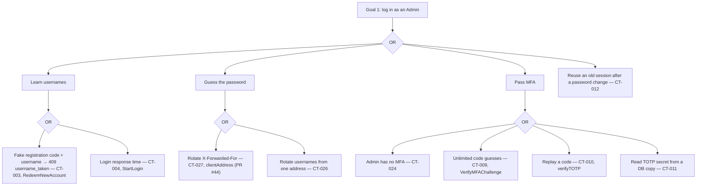
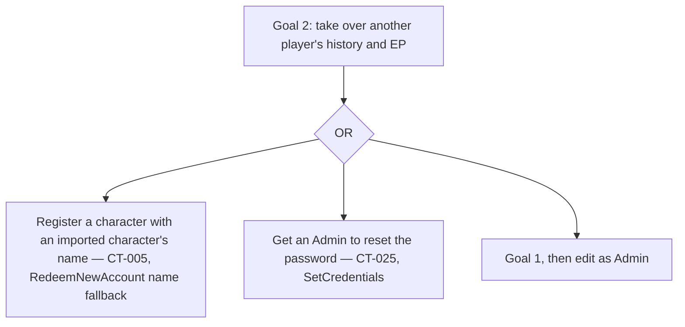
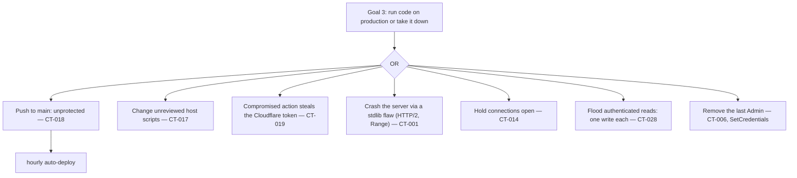

# Code Threat Model — raid-website

This file owns threats found in the **implementation**: the code on `main`
(`376185e`, v1.0.27), its dependencies, CI workflows, and repository settings, reviewed on
2026-10-23. It complements `THREAT_MODEL.md`, which models the specification only. Code threats
have stable IDs `CT-nnn` that are never reused. Each links the `SC-*` rule it breaks; where no rule
existed, a rule was added to `SECURITY.md` and a spec threat to `THREAT_MODEL.md`.

## Method

The seven frameworks of the OWASP Threat Modeling Cheat Sheet were applied to the **code**, each
from its own angle, together with code-specific techniques:

| Framework or technique | Applied to the code as | Section |
| --- | --- | --- |
| STRIDE | Six categories per code component, data flow, and trust boundary | [STRIDE per code component](#stride-per-code-component) |
| Attack trees | Attacker goals decomposed into concrete code paths (file and function) | [Attack trees](#attack-trees) |
| Misuse or abuse cases | Each write endpoint tried out of order, repeatedly, concurrently, and for an unintended outcome, checked in the code | [Misuse and abuse cases](#misuse-and-abuse-cases) |
| LINDDUN | The personal data the code actually stores, logs, and sends | [LINDDUN](#linddun) |
| PASTA | Business objectives → code weaknesses → business impact | [PASTA](#pasta) |
| OCTAVE | Organisational and operational evidence: repository, CI, host scripts, people | [OCTAVE](#octave) |
| VAST | Every code threat tagged as application or operational; two separate views | [VAST](#vast), `VAST` column in [Coverage](#coverage) |
| Software composition analysis | `govulncheck v1.1.4` with the toolchain `go.mod` names (`go1.26.0`); `npm audit` | CT-001, CT-002 |
| Pattern search and manual secure code review | SQL, error text, URL and HTML sinks, parser indexing, secrets in JSON; every ID-taking write; auth flows; account administration; CI | [Register](#register), [Checked without a finding](#checked-without-a-finding) |
| OWASP Top 10:2021 | Checklist | [OWASP Top 10 checklist](#owasp-top-10-checklist) |

Status values: `CONFIRMED` (seen in the code), `FIX PENDING` (a fix is open), `FIXED` (the fix is
on `main`; the issue or pull request is named), `ACCEPTED` (owner
decision or design), `DECISION` (needs an owner decision). Each threat has a Shostack response.
No numeric risk scores; the **Impact** line says in words what an attacker gains.

## Register

### Dependencies and toolchain

**CT-001 — Known vulnerabilities in the Go standard library**
- **Category:** Denial of service, Information disclosure, Spoofing. **Component:** whole binary.
- **Evidence:** `govulncheck` reports 29 vulnerabilities whose vulnerable functions the code
  actually reaches with `go1.26.0`, among them HTTP/2 server memory exhaustion and crash
  (GO-2026-6603, GO-2026-6617), unbounded Range headers (GO-2026-6609), request desynchronisation
  (GO-2026-6613), and several `crypto/x509` flaws reached through WebAuthn (GO-2026-4866,
  GO-2026-6809). All are fixed in `go1.26.10`. `go.mod` says `go 1.26.0` and has no `toolchain`
  line, so a host whose Go is older than `1.26.10` builds a vulnerable binary; the production
  build scripts are not in the repository (CT-017), so the host's Go version is unknown. CI uses
  the newest `1.26.x`. 19 further findings in modules are not reachable.
- **Impact:** a remote visitor can crash or slow the server; certificate checks in WebAuthn are
  weaker than intended.
- **Status:** FIX PENDING (#102; production after reinstalling the update unit). **Response:** Mitigate. **Rules:** SC-045, SC-039.

**CT-002 — Frontend dependencies**
- **Evidence:** `npm audit` reports 0 vulnerabilities (runtime and dev).
- **Status:** none found.

### Authentication and accounts

**CT-003 — Username probing through registration**
- **Category:** Information disclosure. **Component:** `registration.RedeemNewAccount`
  (`internal/registration/service.go:554`).
- **Evidence:** the "username already taken" check runs *before* the registration code is
  validated, and the endpoint is public and not rate-limited. Anyone can send any username with a
  made-up code and read `409 username_taken`. A race between that check and the insert surfaces
  as a database error instead.
- **Impact:** a list of valid login names for password guessing (helps CT-026).
- **Status:** CONFIRMED. **Response:** Mitigate. **Rules:** SC-046 (new), SC-028.

**CT-004 — Username probing through login timing**
- **Evidence:** `auth.StartLogin` returns before any bcrypt comparison for unknown usernames.
- **Status:** FIXED (PR #120, issue #61). **Response:** Mitigate. **Rules:** SC-009.

**CT-005 — A new login can attach to another player by character name**
- **Category:** Spoofing, Elevation of privilege. **Component:** `RedeemNewAccount`.
- **Evidence:** when no character is linked to the requested Rising-Gods profile, the code falls
  back to `FindByName(req.CharacterName)` and gives the new login to the player who owns that
  character — if that player has no login yet. Character names are not unique and can be reused
  after renames (FR-6.3). ADR 084 describes this fallback on purpose for players imported before
  logins existed.
- **Impact:** someone whose new character carries the name of an old imported character gets that
  player's history and EP. The Admin issues the code and can see the linked player afterwards
  (FR-4.9).
- **Status:** CONFIRMED. **Response:** Mitigate (OD-016: Admin confirms). **Rules:** FR-4.5, SC-049.

**CT-006 — The last Admin can be demoted**
- **Category:** Denial of service (administration). **Component:** `auth.SetCredentials`.
- **Evidence:** any Admin can set any player's role, including their own and the last Admin's;
  there is no guard. `BootstrapAdmin` never changes an existing account, so a restart does not
  restore access.
- **Impact:** nobody can administer the site without editing the database by hand.
- **Status:** CONFIRMED. **Response:** Mitigate. **Rules:** SC-047 (new), FR-5.9 (new).

**CT-007 — Internal error text returned to clients**
- **Category:** Information disclosure. **Components:** `internal/httpapi/v1/auth.go:428`
  (`setAccount`), and handlers that pass `err.Error()` of wrapped domain errors
  (`character_merge.go`, `characters.go`, `players.go`, `raids.go`, `raidseries.go`).
- **Evidence:** `setAccount` answers every unexpected error, database failures included, with
  `422` and the raw error chain (for example a constraint name or `bcrypt: password length exceeds
  72 bytes`). The others send sentinel texts that may carry wrapping context.
- **Impact:** small (Admin-only or staff-only), but it breaks SC-023 and misreports server errors
  as client errors.
- **Status:** CONFIRMED. **Response:** Mitigate. **Rules:** SC-023, SC-005.

**CT-008 — Cloned security keys are not detected**
- **Category:** Spoofing. **Component:** `auth.FinishWebAuthnMFA`, `updateWebAuthnCredential`.
- **Evidence:** the WebAuthn library reports a clone warning when the authenticator's signature
  counter goes backwards; the code stores the new counter but never checks the warning.
- **Impact:** a copied authenticator keeps working unnoticed (rare for hardware keys).
- **Status:** CONFIRMED. **Response:** Mitigate. **Rules:** SC-048 (new).

**CT-009 — MFA codes can be guessed without limit** — `VerifyMFAChallenge` had no failure counter.
- **Status:** FIXED (PR #121, issue #62). **Response:** Mitigate. **Rules:** SC-011.

**CT-010 — TOTP codes can be replayed** — no last-used time step is stored.
- **Status:** CONFIRMED. **Response:** Mitigate. **Rules:** SC-012.

**CT-011 — TOTP secrets stored in plaintext** — `mfa_settings.totp_secret`.
- **Status:** CONFIRMED. **Response:** Mitigate. **Rules:** SC-014.

**CT-012 — Sessions outlive password and role changes; no idle timeout** — only account merge ends
sessions; validation checks only the 30-day expiry.
- **Status:** CONFIRMED. **Response:** Mitigate. **Rules:** SC-017, SC-018.

**CT-024 — MFA not enforced for Admins** — **Status:** FIX PENDING (#69). **Rules:** SC-040.

**CT-025 — Admins reset passwords directly** — no reset-code flow. **Status:** CONFIRMED.
**Rules:** SC-042.

**CT-026 — No per-address login limit** — only per username and address. **Status:** FIXED (PR #119,
issue #60). **Rules:** SC-043.

### Request handling

**CT-013 — CSRF check skipped without browser headers** — `csrfProtection` passes requests that
carry neither `Origin` nor `Sec-Fetch-Site`. **Status:** CONFIRMED. **Rules:** SC-019.

**CT-014 — No HTTP server timeouts** — `http.ListenAndServe` in `cmd/server/main.go`; also leaves
GO-2026-6089 (HTTP/2 check without `ReadHeaderTimeout`) more exposed. **Status:** CONFIRMED.
**Rules:** SC-026.

**CT-015 — No visitor limit on Rising-Gods lookups and registration requests.** **Status:**
CONFIRMED. **Rules:** SC-028.

**CT-021 — WebAuthn origin falls back to forwarded headers** — production starts without
`PUBLIC_ORIGIN`; `webAuthnRelyingParty` then trusts `X-Forwarded-Host`. **Status:** CONFIRMED.
**Rules:** SC-007.

**CT-027 — Client address from the first `X-Forwarded-For` entry** — bypasses the login limit.
**Status:** FIXED (PR #44, issue #59). **Rules:** SC-006.

### Data, logging, and privacy

**CT-016 — Security records never deleted** — `auth.Repo.DeleteExpired` is never called; login
attempts, sessions, and MFA challenges accumulate. **Status:** CONFIRMED. **Rules:** SC-038.

**CT-020 — Class icons hotlinked** — `ClassEmblem.tsx` loads from `wow.zamimg.com`. **Status:**
CONFIRMED. **Rules:** SC-024.

**CT-023 — No security event logging** — no log calls in `internal/auth`. **Status:** CONFIRMED.
**Rules:** SC-041.

### Build, deploy, and repository

**CT-017 — Host scripts not in the repository** — `.gitignore` line `bin/` excludes `deploy/bin/`.
**Status:** CONFIRMED. **Rules:** SC-037.

**CT-018 — `main` unprotected** — GitHub API: `protected: false`; ruleset "Protect" disabled.
**Status:** FIXED (ruleset "Protect" active 2026-10-23, #107). **Rules:** SC-039.

**CT-019 — Actions pinned by tag; no Dependabot** — `.github/workflows/*.yml`. **Status:**
CONFIRMED. **Rules:** SC-036.

**CT-022 — Over-long passwords reach bcrypt** — `ValidatePassword` checks only the minimum; bcrypt
then fails and the error surfaces through CT-007. **Status:** CONFIRMED. **Rules:** SC-005.

### Found while applying the frameworks

**CT-028 — Every authenticated request writes to the database**
- **Category:** Denial of service. **Component:** `auth.Service.Authenticate` → `TouchSession`.
- **Evidence:** each request with a session cookie updates `sessions.last_seen_at`. With one
  SQLite connection (DR-9), every page load of a logged-in user queues behind writes, and a busy
  raid night multiplies the writes. SC-018 allows updating at most once per hour.
- **Impact:** slower responses and lock contention under load; an attacker with a session can
  force a write per request.
- **Status:** CONFIRMED. **Response:** Mitigate. **Rules:** SC-018.

**CT-029 — Every login is kept as an activity record (LINDDUN Detecting, Linking)**
- **Category:** Information disclosure (privacy). **Component:** `auth.recordLoginAttempt`.
- **Evidence:** successful logins are stored too (`success = true`, `internal/auth/service.go:302`,
  `:319`) with username and client address, and nothing is ever deleted (CT-016). Over time the
  table becomes a log of when and from where each member logged in.
- **Impact:** a database copy reveals members' login times and IP addresses for the whole history.
- **Status:** CONFIRMED. **Response:** Eliminate. **Rules:** SC-038 (only the limit window is kept).

**CT-030 — Raw Rising-Gods profiles kept forever (LINDDUN Data disclosure, Non-compliance)**
- **Category:** Information disclosure (privacy: data minimisation). **Component:**
  `registration_requests.raw_profile_json`, `characters.external_profile_json`.
- **Evidence:** the full profile response is stored on every registration request (also rejected
  and consumed ones) and every linked character; only name, class, specs, and gear score are used.
  The data is public on Rising-Gods, so sensitivity is low; anonymisation deletes it (FR-30.2).
- **Status:** CONFIRMED. **Response:** Eliminate (OD-017). **Rules:** SC-050.

## Checked without a finding

- **SQL injection:** all queries use Bun builders or `?` binding; the one dynamic column
  (`internal/recruitment/service.go:144`) is chosen from two constants; raw catalog queries are
  constant strings.
- **Broken object-level authorisation:** item locks (owner and lock owner checked), wishlist
  writes, signup save and withdraw, absences (others only for staff), security-key removal
  (credential owner checked), claim codes (bound to the requesting player), registration codes
  (purpose and requester checked) — all enforced in the domain service.
- **Mass assignment:** DTOs with `DisallowUnknownFields`; character edits cannot set the owner.
- **Secrets in responses:** password hashes, token and code hashes, TOTP secrets, WebAuthn data,
  and raw Rising-Gods JSON are tagged `json:"-"`; audit snapshots of registration requests omit
  codes.
- **Client-side injection:** no `dangerouslySetInnerHTML`, `innerHTML`, or `eval`; link targets
  are built by the server (`profileURL`) or from encoded IDs; CSP blocks `javascript:` URLs.
- **Parser crashes:** RS1/RS2 parsers check field counts before indexing.
- **Server-side request forgery:** outbound requests go only to the fixed Rising-Gods origin or the
  configured Worker.
- **CI:** `permissions: contents: read`; `pull_request`, not `pull_request_target`; the Cloudflare
  token is used only on `main` pushes.

## STRIDE per code component

"—" means the category was checked in that code and nothing was found.

| Code component | S | T | R | I | D | E |
| --- | --- | --- | --- | --- | --- | --- |
| `internal/httpapi` middleware (headers, CSRF, session) | CT-013, CT-027 | — | — | — | CT-014, CT-028 | — |
| `internal/httpapi/v1` handlers | — | — | — | CT-007 | — | — |
| `internal/auth` (login, MFA, sessions) | CT-004, CT-009, CT-010, CT-012, CT-026 | — | CT-023 | CT-004, CT-011, CT-029 | CT-028 | CT-024 |
| `internal/auth/webauthn.go` | CT-008, CT-021 | — | — | — | — | — |
| `internal/registration` (codes, Rising-Gods) | CT-003, CT-005 | — | — | CT-003, CT-030 | CT-015 | CT-005 |
| Account administration (`auth.SetCredentials`, `accountmerge`) | CT-025 | — | — | CT-007 | CT-006 | — |
| Domain services and SQL | — | none found | — | — | — | none found |
| Web client (`web/src`) | — | none found | — | CT-020 | — | — |
| Dependencies and toolchain | CT-001 | CT-001 | — | CT-001 | CT-001 | — |
| CI, repository, host scripts | — | CT-017, CT-018, CT-019 | — | — | — | CT-017, CT-018 |
| Database (`login_attempts`, `sessions`, profiles) | — | — | — | CT-011, CT-016, CT-029, CT-030 | CT-016 | — |

## Attack trees

OR = any child is enough. Each leaf names the code path.

## Misuse and abuse cases

Each write was tried, in the code, out of order, repeatedly, concurrently, and for an unintended
outcome.

| Endpoint / workflow | Out of order | Repeated | Concurrent | Unintended outcome |
| --- | --- | --- | --- | --- |
| Enhanced loot (`loot.Service`) | Recipient must be in the roster | `request_id` looked up in the write transaction (`GetByRequest`, `GetByRaidRequest`) | One connection; unique index `idx_loot_raid_request` | — |
| Archive (`raidcompletion`) | Series, start, roster checked first | Already archived returns the stored successor | Serialized writes | Linked successor checks (`service.go:164`) |
| Signup save / withdraw (`raidsignup`) | Server clock `s.now()` against the scheduled start | Upsert per character | Same transaction | Accepted choice cannot be withdrawn |
| Absence (`raidsignup.Decline`) | Own absence only before start; staff for others | Upsert | Same | — |
| Item lock (`enhancepoints.CreateLock`) | Raid state checked | Competing lock rejected | Check and insert in one transaction | Hoarding allowed by rule (T-031) |
| Registration redeem | **Username checked before the code (CT-003)** | Code single-use in the transaction | Username race surfaces as a database error (CT-003) | **Name fallback (CT-005)** |
| Claim redeem | Code bound to requester | Single-use | Transaction | Moves a character only with an in-game code |
| Account save (`SetCredentials`) | — | — | — | **Last Admin can be removed (CT-006)** |
| Poll vote | Closed or past `closes_at` rejected | Upsert per player | `ON CONFLICT` | — |
| Every authenticated GET | — | **Each one writes `last_seen_at` (CT-028)** | Queues behind writes | — |

## LINDDUN

Personal data the code actually handles:

| Data | Where | Kept |
| --- | --- | --- |
| Login name, password hash | `players` | Until anonymisation |
| Username + client address of **every** login, failed or successful | `login_attempts` | Forever (CT-016, CT-029) |
| Sessions with `last_seen_at` | `sessions` | Forever after expiry (CT-016) |
| TOTP secret, recovery-code hashes, WebAuthn credentials | `mfa_*`, `webauthn_*` | Until disabled; TOTP in plaintext (CT-011) |
| Raw Rising-Gods profile JSON | `registration_requests`, `characters` | Forever (CT-030) |
| Absence notes, wishlist notes, poll answers | Domain tables | Forever (history) |
| Audit snapshots (names, roles, changes) | `audit_log` | Forever (T-039, accepted) |
| Request path, status, duration | systemd journal | Journal retention |
| Recruitment drafts | Browser `localStorage` (per raid) | In the browser |
| Visitor IP to a third party | `wow.zamimg.com` image requests | Third party (CT-020) |

| Category | Code findings |
| --- | --- |
| Linking | `login_attempts` links usernames to IP addresses over time (CT-029). |
| Identifying | IP addresses next to usernames identify people (CT-029); raw profiles add realm details (CT-030). |
| Non-repudiation | Audit snapshots attribute every change permanently (accepted, T-039). |
| Detecting | Successful-login records reveal when members are active (CT-029); third-party image loads reveal visits (CT-020). |
| Data disclosure | Plaintext TOTP secrets (CT-011); never-deleted security records (CT-016). |
| Unawareness | No privacy page in the code yet (FR-30.1 not built). |
| Unintervenability | No export (FR-30.7) or anonymisation (FR-30.2) in the code yet. |
| Non-compliance | Retention without limit for `login_attempts`, sessions, raw profiles (CT-016, CT-029, CT-030). |

## PASTA

1. **Business objectives:** a trusted EP and loot record; the site up on raid nights; members'
   data handled lawfully; little work for one maintainer.
2. **Technical scope:** the Go binary, SQLite, the SPA, CI, and the host scripts on `main`.
3. **Decomposition:** [STRIDE per code component](#stride-per-code-component).
4. **Threat analysis:** [Attack trees](#attack-trees).
5. **Weakness analysis:** the `CONFIRMED` register entries; CT-001 is the only one reachable by any
   anonymous visitor without further steps.
6. **Attack modeling:** the three attack trees; the shortest paths are CT-018 (push to `main`) and
   CT-001 (crash through a stdlib flaw).
7. **Business impact (in words):**
   - **Highest:** CT-018 and CT-017 — anyone who gets a commit onto `main` controls production
     and all data within an hour; CT-005 — a player's fairness record can end up in the wrong hands.
   - **High:** CT-001 — raid-night outages from public requests; CT-024/CT-009/CT-011 — weaker
     protection of the Admin account.
   - **Medium:** CT-003, CT-004, CT-026, CT-027 — easier password guessing; CT-006 — lost
     administration until manual repair.
   - **Lower:** CT-007, CT-008, CT-028, CT-029, CT-030, CT-020 — information leaks, performance,
     and privacy hygiene.

## OCTAVE

- **Critical assets (as found):** the `main` branch and its hourly deploy; the Admin accounts; the
  SQLite file and its on-host snapshots.
- **Operational evidence:** `main` unprotected and the ruleset disabled (CT-018); the root-run
  publisher, updater, backup, and firewall scripts exist only outside the repository (CT-017); the
  production Go version is unknown (CT-001); Actions pinned by tag (CT-019); one maintainer
  holds every credential (T-040, accepted).
- **What already works in practice:** CI runs build, lint, unit, frontend, and end-to-end tests on
  every push and pull request with read-only permissions; systemd sandboxing and an unprivileged
  build user are in the templates; snapshots are verified weekly.
- **Strategy (order of work):** 1) protect `main` and add the vulnerability scan (CT-018, CT-001,
  SC-039, SC-045); 2) commit the host scripts (CT-017); 3) Admin protection (CT-024, CT-009,
  CT-010, CT-011, CT-026, CT-027); 4) account flows (CT-003, CT-005, CT-006, CT-025); 5) privacy
  hygiene and performance (CT-016, CT-028 to CT-030).

## VAST

Two separate views, maintained in the backlog as separate workstreams.

- **Application threat model (code in `cmd/`, `internal/`, `web/`):** CT-003 to CT-016, CT-020 to
  CT-030.
- **Operational threat model (toolchain, CI, repository, host):** CT-001, CT-017, CT-018, CT-019;
  CT-001 also needs an application change (`go.mod`).

## OWASP Top 10 checklist

| OWASP Top 10:2021 | Code threats |
| --- | --- |
| A01 Broken Access Control | CT-006, CT-027 (none in object-level checks) |
| A02 Cryptographic Failures | CT-011, CT-008 |
| A03 Injection | none found |
| A04 Insecure Design | CT-005, CT-028 |
| A05 Security Misconfiguration | CT-007, CT-013, CT-014, CT-018, CT-021 |
| A06 Vulnerable and Outdated Components | CT-001, CT-019 |
| A07 Identification and Authentication Failures | CT-003, CT-004, CT-009, CT-010, CT-012, CT-022, CT-024 to CT-026 |
| A08 Software and Data Integrity Failures | CT-017, CT-018, CT-019 |
| A09 Security Logging and Monitoring Failures | CT-023 |
| A10 Server-Side Request Forgery | none found |
| Privacy (not in the Top 10) | CT-016, CT-020, CT-029, CT-030 |

## Coverage

| Code threat | Status | Response | VAST | Rule | Spec threat |
| --- | --- | --- | --- | --- | --- |
| CT-001 | FIX PENDING | Mitigate | Ops + App | SC-045, SC-039 | T-046 |
| CT-003 | CONFIRMED | Mitigate | App | SC-046 | T-042 |
| CT-004 | FIXED | Mitigate | App | SC-009 | T-004 |
| CT-005 | CONFIRMED | Mitigate | App | SC-049, FR-4.5 | T-043 |
| CT-006 | CONFIRMED | Mitigate | App | SC-047 | T-044 |
| CT-007 | CONFIRMED | Mitigate | App | SC-023 | — |
| CT-008 | CONFIRMED | Mitigate | App | SC-048 | T-045 |
| CT-009 | FIXED | Mitigate | App | SC-011 | T-005 |
| CT-010 | CONFIRMED | Mitigate | App | SC-012 | T-006 |
| CT-011 | CONFIRMED | Mitigate | App | SC-014 | T-011 |
| CT-012 | CONFIRMED | Mitigate | App | SC-017, SC-018 | T-010 |
| CT-013 | CONFIRMED | Mitigate | App | SC-019 | T-007 |
| CT-014 | CONFIRMED | Mitigate | App | SC-026 | T-017 |
| CT-015 | CONFIRMED | Mitigate | App | SC-028 | T-016, T-035 |
| CT-016 | CONFIRMED | Eliminate | App | SC-038 | T-022 |
| CT-017 | CONFIRMED | Mitigate | Ops | SC-037 | T-013 |
| CT-018 | FIXED | Mitigate | Ops | SC-039 | T-012 |
| CT-019 | CONFIRMED | Mitigate | Ops | SC-036 | T-014 |
| CT-020 | CONFIRMED | Eliminate | App | SC-024 | T-024 |
| CT-021 | CONFIRMED | Mitigate | App | SC-007 | T-008 |
| CT-022 | CONFIRMED | Mitigate | App | SC-005 | — |
| CT-023 | CONFIRMED | Mitigate | App | SC-041 | T-021 |
| CT-024 | FIX PENDING | Mitigate | App | SC-040 | T-020 |
| CT-025 | CONFIRMED | Mitigate | App | SC-042 | T-026 |
| CT-026 | FIXED | Mitigate | App | SC-043 | T-003 |
| CT-027 | FIXED | Mitigate | App | SC-006 | T-001 |
| CT-028 | CONFIRMED | Mitigate | App | SC-018 | T-010 |
| CT-029 | CONFIRMED | Eliminate | App | SC-038 | T-022 |
| CT-030 | CONFIRMED | Eliminate | App | SC-050, FR-30.6 | T-047 |

CT-002 found nothing and has no row.

## Limits

- Domain services were reviewed for authorisation and the listed classes, not line by line for
  every business rule.
- The installed production host, its Go version, and the missing `deploy/bin/` scripts could not be
  inspected.
- Who has push access to the repository could not be read.
- No dynamic testing (DAST, fuzzing) was run.
