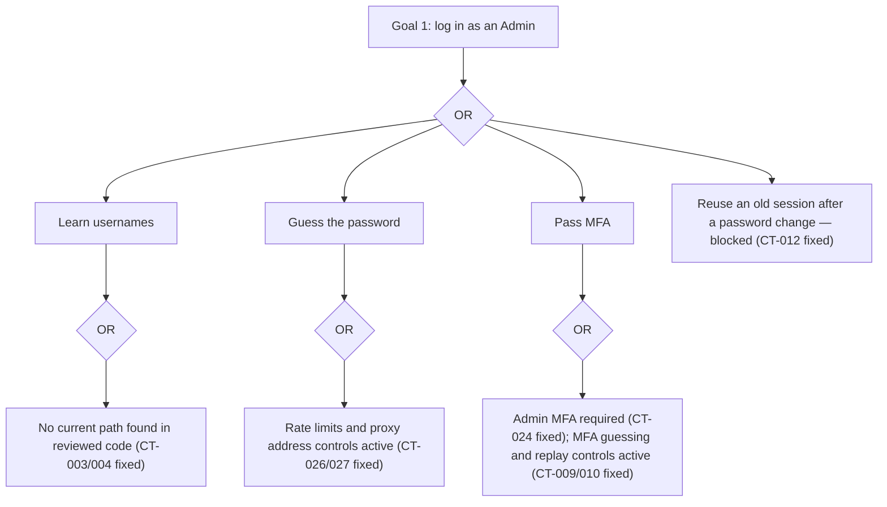
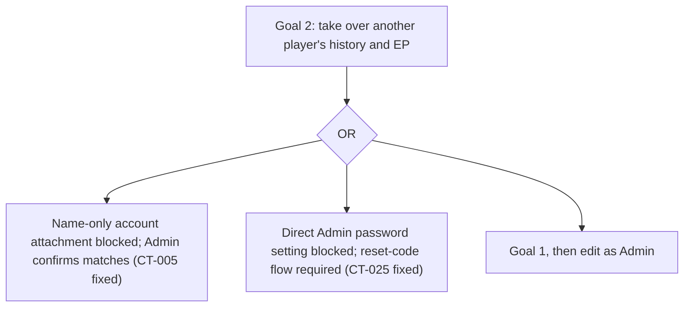
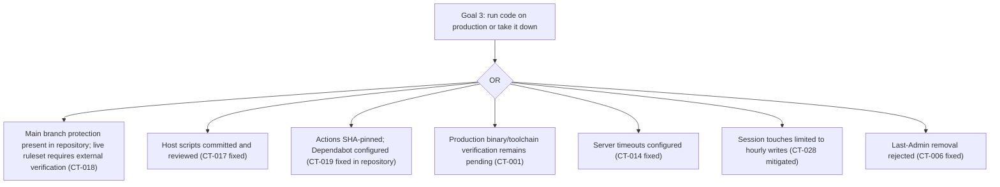

# Code Threat Model — raid-website

This file owns threats found in the **implementation**: the code on `main`
(`d0f67d6`, v1.0.87), its dependencies, CI workflows, and repository settings, reviewed on
2026-11-11. It complements `THREAT_MODEL.md`, which models the specification only. Code threats
have stable IDs `CT-nnn` that are never reused. Each links the `SC-*` rule it breaks; where no rule
existed, a rule was added to `SECURITY.md` and a spec threat to `THREAT_MODEL.md`.

## Method

The seven frameworks of the OWASP Threat Modeling Cheat Sheet were applied to the **code**, each
from its own angle, together with code-specific techniques:

| Framework or technique | Applied to the code as | Section |
| --- | --- | --- |
| STRIDE | Six categories per code component, data flow, and trust boundary | [STRIDE per code component](#stride-per-code-component) |
| Attack trees | Attacker goals decomposed into concrete code paths (file and function) | [Attack trees](#attack-trees) |
| Misuse or abuse cases | Each write endpoint tried out of order, repeatedly, concurrently, and for an unintended outcome, checked in the code | [Misuse and abuse cases](#misuse-and-abuse-cases) |
| LINDDUN | The personal data the code actually stores, logs, and sends | [LINDDUN](#linddun) |
| PASTA | Business objectives → code weaknesses → business impact | [PASTA](#pasta) |
| OCTAVE | Organisational and operational evidence: repository, CI, host scripts, people | [OCTAVE](#octave) |
| VAST | Every code threat tagged as application or operational; two separate views | [VAST](#vast), `VAST` column in [Coverage](#coverage) |
| Software composition analysis | CI `govulncheck` and `npm audit`; recorded review results are time-sensitive | CT-001, CT-002 |
| Pattern search and manual secure code review | SQL, error text, URL and HTML sinks, parser indexing, secrets in JSON; every ID-taking write; auth flows; account administration; CI | [Register](#register), [Checked without a finding](#checked-without-a-finding) |
| OWASP Top 10:2021 | Checklist | [OWASP Top 10 checklist](#owasp-top-10-checklist) |

Status values: `CONFIRMED` (currently present in the code), `FIX PENDING` (a fix is open), `FIXED`
(the finding is no longer present in the repository), `MITIGATED` (controls reduce the risk but
verification remains), `ACCEPTED` (owner decision or design), `DECISION` (needs an owner decision).
Fixed findings are retained as history and MUST NOT be read as current attack paths. Each threat has a Shostack response.
No numeric risk scores; the **Impact** line says in words what an attacker gains.

## Register

### Dependencies and toolchain

**CT-001 — Known vulnerabilities in the Go standard library**
- **Category:** Denial of service, Information disclosure, Spoofing. **Component:** whole binary.
- **Evidence:** `govulncheck` reports 29 vulnerabilities whose vulnerable functions the code
  actually reached with `go1.26.0`, among them HTTP/2 server memory exhaustion and crash
  (GO-2026-6603, GO-2026-6617), unbounded Range headers (GO-2026-6609), request desynchronisation
  (GO-2026-6613), and several `crypto/x509` flaws reached through WebAuthn (GO-2026-4866,
  GO-2026-6809). These findings are fixed in `go1.26.10`. A later scan found GO-2026-6859,
  reachable in `go1.26.10` and fixed in `go1.26.11`. `go.mod` now names `toolchain go1.26.11`,
  CI checks its Go version and runs `govulncheck`, and the update service sets `GOTOOLCHAIN=auto`
  (SC-045). The production binary/unit still requires host verification. The original scan also
  found 19 module findings that were not reachable.
- **Impact:** If production still runs a binary built with the vulnerable standard library, a
  remote visitor could cause availability or WebAuthn certificate-validation impact; the installed
  production binary has not been verified in this review.
- **Status:** FIXED in the repository by upgrading to `go1.26.11`; production verification remains pending (SC-045). **Response:** Mitigate. **Rules:** SC-045, SC-039.

**CT-002 — Frontend dependencies**
- **Evidence:** The recorded `npm audit` found 0 vulnerabilities (runtime and dev); this result is time-sensitive. CI currently runs `npm audit --omit=dev --audit-level=high`.
- **Status:** no finding in the recorded scan. CI checks runtime dependencies (`--omit=dev`); development-dependency exposure was not rechecked here.

### Authentication and accounts

**CT-003 — Username probing through registration**
- **Category:** Information disclosure. **Component:** `registration.RedeemNewAccount`
  (`internal/registration/service.go:554`).
- **Evidence:** This was present in the reviewed implementation. Fixed since #75:
  `RedeemNewAccount` validates/consumes the code before checking the username, inside the
  transaction; invalid codes cannot act as a username oracle. See SC-046 and `TestReqAccount010_*`.
- **Impact:** a list of valid login names for password guessing (helps CT-026).
- **Status:** FIXED (#75). **Response:** Mitigate. **Rules:** SC-046, SC-028.

**CT-004 — Username probing through login timing**
- **Evidence:** `auth.StartLogin` returns before any bcrypt comparison for unknown usernames.
- **Status:** FIXED (PR #120, issue #61). **Response:** Mitigate. **Rules:** SC-009.

**CT-005 — A new login can attach to another player by character name**
- **Category:** Spoofing, Elevation of privilege. **Component:** `RedeemNewAccount`.
- **Evidence:** The name-only automatic fallback was removed in #77. The Admin's explicit match
  choice is stored with the code; redemption follows that choice and otherwise creates a new player
  (SC-049). Character names can be reused after renames (FR-6.3), so this explicit confirmation
  remains an important control.
- **Impact:** someone whose new character carries the name of an old imported character gets that
  player's history and EP. The Admin issues the code and can see the linked player afterwards
  (FR-4.9).
- **Status:** FIXED (#77; residual risk is controlled by Admin confirmation). **Response:** Mitigate (OD-016). **Rules:** FR-4.5, SC-049.

**CT-006 — The last Admin can be demoted**
- **Category:** Denial of service (administration). **Component:** `auth.SetCredentials`.
- **Evidence:** Fixed since #80: `auth.SetCredentials` and account merge count active Admins in
  the write transaction and reject changes that would remove the last active Admin (`409
  last_admin`); see SC-047. Anonymisation uses the same guard.
- **Impact:** nobody can administer the site without editing the database by hand.
- **Status:** FIXED (#80). **Response:** Mitigate. **Rules:** SC-047, FR-5.9.

**CT-007 — Internal error text returned to clients**
- **Category:** Information disclosure. **Components:** API error writers, previously including
  `auth.go` (`setAccount`), `character_merge.go`, `characters.go`, `players.go`, `raids.go`, and
  `raidseries.go`.
- **Evidence:** The previously reported account-save path now logs unexpected errors and returns a
  generic `500 internal`. A current search of the named handlers found no direct `err.Error()`
  response path; SC-023 records that response writers do not return error text, and
  `stable_errors_test.go` guards against leaking it.
- **Impact:** small (Admin-only or staff-only), but it breaks SC-023 and misreports server errors
  as client errors.
- **Status:** FIXED (#113 for account save; safe error handling confirmed across the named handlers, SC-023). **Response:** Mitigate. **Rules:** SC-023, SC-005.

**CT-008 — Cloned security keys are not detected**
- **Category:** Spoofing. **Component:** `auth.FinishWebAuthnMFA`, `updateWebAuthnCredential`.
- **Evidence:** the WebAuthn library reports a clone warning when the authenticator's signature
  counter goes backwards; the code stores the new counter but never checks the warning.
- **Impact:** a copied authenticator keeps working unnoticed (rare for hardware keys).
- **Status:** FIXED (issue #70). **Response:** Mitigate. **Rules:** SC-048.

**CT-009 — MFA codes can be guessed without limit** — `VerifyMFAChallenge` had no failure counter.
- **Status:** FIXED (PR #121, issue #62). **Response:** Mitigate. **Rules:** SC-011.

**CT-010 — TOTP codes can be replayed** — no last-used time step was stored.
- **Status:** FIXED (PR #122, issue #63). **Response:** Mitigate. **Rules:** SC-012.

**CT-011 — TOTP secrets stored in plaintext** — `mfa_settings.totp_secret`.
- **Evidence:** Fixed in #64/#65: TOTP secrets are encrypted at rest and startup transactionally migrates plaintext or old-key values; see SC-014.
- **Status:** FIXED (#64/#65). **Response:** Mitigate. **Rules:** SC-014.

**CT-012 — Sessions outlive password and role changes; no idle timeout**
- **Evidence:** Fixed in #66/#67: credential or role changes revoke sessions as specified, and sessions expire after 7 days idle or 30 days absolute; touch writes are limited to once per hour (SC-017/018).
- **Status:** FIXED (#66/#67). **Response:** Mitigate. **Rules:** SC-017, SC-018.

**CT-024 — MFA not enforced for Admins** — Admin-only routes enforce MFA setup; **Status:** FIXED (#69). **Rules:** SC-040.

**CT-025 — Admins reset passwords directly** — Admins cannot directly set another player's password; reset-code flow is implemented. **Status:** FIXED (#81/#82).
**Rules:** SC-042.

**CT-026 — No per-address login limit** — only per username and address. **Status:** FIXED (PR #119,
issue #60). **Rules:** SC-043.

### Request handling

**CT-013 — CSRF check skipped without browser headers** — Fixed in #68: every state-changing
request requires a CSRF token regardless of browser headers or session cookie (SC-019).
**Status:** FIXED. **Rules:** SC-019.

**CT-014 — No HTTP server timeouts** — Fixed in the current server: `http.Server` sets read-header,
read, write, and idle timeouts and performs graceful shutdown (SC-026). **Status:** FIXED.
**Rules:** SC-026.

**CT-015 — No visitor limit on Rising-Gods lookups and registration requests.** Fixed since #79:
the shared per-address visitor budget limits uncached lookups and registration requests (SC-028).
**Status:** FIXED. **Rules:** SC-028.

**CT-021 — WebAuthn origin falls back to forwarded headers** — Fixed since #71: production requires
HTTPS `PUBLIC_ORIGIN`; WebAuthn uses that configured origin and does not trust forwarded headers
(SC-007). **Status:** FIXED.
**Rules:** SC-007.

**CT-027 — Client address from the first `X-Forwarded-For` entry** — bypasses the login limit.
**Status:** FIXED (PR #44, issue #59). **Rules:** SC-006.

### Data, logging, and privacy

**CT-016 — Security records never deleted** — Fixed by #74: startup and login prune old login
attempts, expired sessions, and expired/used MFA and WebAuthn challenges (SC-038). **Status:** FIXED.

**CT-020 — Third-party item icons disclose visitor IPs** — Class icons are served locally. Item
icons in the loot catalog still load from `wow.zamimg.com` by design (ADR 104, SC-024), so a visitor
viewing that catalog discloses an IP address to the image host. **Status:** ACCEPTED by design for
item icons; class-icon part fixed. **Rules:** SC-024.

**CT-023 — No security event logging** — Structured security events are emitted at the HTTP/API
layer for the events in SC-041; they need not be logged from `internal/auth`. **Status:** FIXED.
**Rules:** SC-041.

### Build, deploy, and repository

**CT-017 — Host scripts not in the repository** — `.gitignore` line `bin/` excludes `deploy/bin/`.
**Status:** FIXED (scripts committed under `deploy/bin/`, host copies identical 2026-10-24, #105). **Rules:** SC-037.

**CT-018 — `main` unprotected** — The GitHub API reported `protected: false` and the "Protect"
ruleset disabled in the original review. **Status:** FIXED at the time of #107; current live
ruleset state has not been externally reverified. **Rules:** SC-039.

**CT-019 — Actions pinned by tag; no Dependabot** — Current workflow actions are pinned to full
commit SHAs and `.github/dependabot.yml` is present. **Status:** FIXED in the repository.
**Rules:** SC-036.

**CT-022 — Over-long passwords reach bcrypt** — Passwords above 1024 bytes are rejected before
hashing, and bcrypt-era hashes are migrated on login; **Status:** FIXED. **Rules:** SC-005.

### Found while applying the frameworks

**CT-028 — Every authenticated request writes to the database**
- **Category:** Denial of service. **Component:** `auth.Service.Authenticate` → `TouchSession`.
- **Evidence:** The original implementation touched the session on every authenticated request.
  Fixed by #67: authentication skips recent touches and the repository conditionally updates at most
  once per hour, including concurrent requests (SC-018).
- **Impact:** The original behavior could increase lock contention under load; the hourly update
  bound mitigates the repeated-write concern.
- **Status:** MITIGATED (#67). Authentication skips recent touches and the repository conditionally updates at most once per hour, including concurrent reads. **Rules:** SC-018.

**CT-029 — Every login is kept as an activity record (LINDDUN Detecting, Linking)**
- **Category:** Information disclosure (privacy). **Component:** `auth.recordLoginAttempt`.
- **Evidence:** Successful logins are not retained as activity history. Login-attempt rows are
  deleted after the longest rate-limit window by `PruneSecurityRecords` (SC-038).
- **Impact:** The original unbounded retention could reveal historical login times and IP addresses
  in a database copy; the current retention window is limited to rate-limiting needs.
- **Status:** FIXED (#74): startup and login keep only the 15-minute limit window. **Response:** Eliminate. **Rules:** SC-038.

**CT-030 — Raw Rising-Gods profiles kept forever (LINDDUN Data disclosure, Non-compliance)**
- **Category:** Information disclosure (privacy: data minimisation). **Component:**
  `registration_requests.raw_profile_json`, `characters.external_profile_json`.
- **Evidence:** The old schema held the full profile response. Fixed in #78: repositories discard
  raw profiles and migration 083 clears existing copies; only the fields permitted by SC-050 remain.
- **Status:** FIXED (#78). **Response:** Eliminate (OD-017). **Rules:** SC-050.

## Checked without a finding

- **SQL injection:** all queries use Bun builders or `?` binding; the one dynamic column
  (`internal/recruitment/service.go:144`) is chosen from two constants; raw catalog queries are
  constant strings.
- **Broken object-level authorisation:** item locks (owner and lock owner checked), wishlist
  writes, signup save and withdraw, absences (others only for staff), security-key removal
  (credential owner checked), claim codes (bound to the requesting player), registration codes
  (purpose and requester checked) — all enforced in the domain service.
- **Mass assignment:** DTOs with `DisallowUnknownFields`; character edits cannot set the owner.
- **Secrets in responses:** password hashes, token and code hashes, TOTP secrets, WebAuthn data,
  and raw Rising-Gods JSON are tagged `json:"-"`; audit snapshots of registration requests omit
  codes.
- **Client-side injection:** no `dangerouslySetInnerHTML`, `innerHTML`, or `eval`; link targets
  are built by the server (`profileURL`) or from encoded IDs; CSP blocks `javascript:` URLs.
- **Parser crashes:** RS1/RS2 parsers check field counts before indexing.
- **Server-side request forgery:** outbound requests go only to the fixed Rising-Gods origin or the
  configured Worker.
- **CI:** `permissions: contents: read`; `pull_request`, not `pull_request_target`; the Cloudflare
  token is used only on `main` pushes.

## STRIDE per code component

"—" means the category was checked in that code and nothing was found.

| Code component | S | T | R | I | D | E |
| --- | --- | --- | --- | --- | --- | --- |
| `internal/httpapi` middleware (headers, CSRF, session) | CT-027 (fixed) | — | — | — | CT-028 (mitigated) | — |
| `internal/httpapi/v1` handlers | CT-007 (fixed), CT-013 (fixed) | — | — | CT-007 (fixed) | — | — |
| `internal/auth` (login, MFA, sessions) | CT-004, CT-009, CT-010, CT-012, CT-026 (fixed) | — | CT-023 (fixed) | CT-004, CT-011 (fixed), CT-029 (mitigated) | CT-028 (mitigated) | CT-024 (fixed) |
| `internal/auth/webauthn.go` | CT-008, CT-021 (fixed) | — | — | — | — | — |
| `internal/registration` (codes, Rising-Gods) | CT-003, CT-005, CT-015, CT-030 (fixed) | — | — | CT-003, CT-030 (fixed) | CT-015 (fixed) | CT-005 (fixed) |
| Account administration (`auth.SetCredentials`, `accountmerge`) | CT-025 (fixed) | — | — | CT-007 (fixed) | CT-006 (fixed) | — |
| Domain services and SQL | — | none found | — | — | — | none found |
| Web client (`web/src`) | — | none found | — | CT-020 (accepted: item icons) | — | — |
| Dependencies and toolchain | CT-001 | CT-001 | — | CT-001 | CT-001 | — |
| CI, repository, host scripts | — | CT-017, CT-018, CT-019 | — | — | — | CT-017, CT-018 |
| Database (`login_attempts`, `sessions`, profiles) | — | — | — | CT-011, CT-016, CT-029, CT-030 (fixed/mitigated) | CT-016 (fixed) | — |

## Attack trees

OR = any child is enough. The trees preserve the reviewed attacker goals and identify whether the
associated finding is fixed, mitigated, or still needs external verification; fixed branches are
not current exploit paths.

## Misuse and abuse cases

Each write was tried, in the code, out of order, repeatedly, concurrently, and for an unintended
outcome.

| Endpoint / workflow | Out of order | Repeated | Concurrent | Unintended outcome |
| --- | --- | --- | --- | --- |
| Enhanced loot (`loot.Service`) | Recipient must be in the roster | `request_id` looked up in the write transaction (`GetByRequest`, `GetByRaidRequest`) | One connection; unique index `idx_loot_raid_request` | — |
| Archive (`raidcompletion`) | Series, start, roster checked first | Already archived returns the stored successor | Serialized writes | Linked successor checks (`service.go:164`) |
| Signup save / withdraw (`raidsignup`) | Server clock `s.now()` against the scheduled start | Upsert per character | Same transaction | Accepted choice cannot be withdrawn |
| Absence (`raidsignup.Decline`) | Own absence only before start; staff for others | Upsert | Same | — |
| Item lock (`enhancepoints.CreateLock`) | Raid state checked | Competing lock rejected | Check and insert in one transaction | Hoarding allowed by rule (T-031) |
| Registration redeem | Code validated before username (CT-003 fixed) | Code single-use in the transaction | Username check is transactional | Name match requires stored Admin choice (CT-005 fixed) |
| Claim redeem | Code bound to requester | Single-use | Transaction | Moves a character only with an in-game code |
| Account save (`SetCredentials`) | Last Admin guard in transaction (CT-006 fixed) | — | — | Last Admin cannot be removed |
| Poll vote | Closed or past `closes_at` rejected | Upsert per player | `ON CONFLICT` | — |
| Authenticated requests | — | Session touch is conditional, at most hourly (CT-028 mitigated) | Concurrent touches are conditional | — |

## LINDDUN

Personal data the code actually handles:

| Data | Where | Kept |
| --- | --- | --- |
| Login name, password hash | `players` | Until anonymisation |
| Username + client address of login attempts | `login_attempts` | Only while needed for the longest rate-limit window; pruned at startup and before login (SC-038) |
| Sessions with `last_seen_at` | `sessions` | Until logout, expiry, or account action; expired sessions are pruned (SC-038) |
| TOTP secret, recovery-code hashes, WebAuthn credentials | `mfa_*`, `webauthn_*` | Until disabled; TOTP secret encrypted at rest (SC-014) |
| Rising-Gods profile fields used by the site | `registration_requests`, `characters` | Raw JSON discarded; legacy copies cleared by migration 083 (SC-050) |
| Absence notes, wishlist notes, poll answers | Domain tables | Forever (history) |
| Audit snapshots (names, roles, changes) | `audit_log` | Forever (T-039, accepted) |
| Request path, status, duration | systemd journal | Journal retention |
| Recruitment drafts | Browser `localStorage` (per raid) | In the browser |
| Visitor IP to a third party | Loot-catalog item icons from `wow.zamimg.com` | Third party by design (CT-020, ADR 104) |

| Category | Code findings |
| --- | --- |
| Linking | Recent failed login attempts link usernames to IP addresses for rate limiting (SC-038). |
| Identifying | Item-icon requests disclose visitor IP addresses to `wow.zamimg.com` (CT-020); raw profiles are not retained (CT-030 fixed). |
| Non-repudiation | Audit snapshots attribute every change permanently (accepted, T-039). |
| Detecting | Item-icon loads reveal catalog visits to the third-party image host (CT-020). |
| Data disclosure | TOTP secrets are encrypted at rest; short-lived security records are pruned (CT-011/016 fixed). |
| Unawareness | Privacy page is implemented (FR-30.1); it documents item-icon requests. |
| Unintervenability | Export and anonymisation flows are implemented (FR-30.2, FR-30.7). |
| Non-compliance | No finding from the old profile/security-record retention issues remains in current repository code (CT-016/029/030 fixed). |

## PASTA

1. **Business objectives:** a trusted EP and loot record; the site up on raid nights; members'
   data handled lawfully; little work for one maintainer.
2. **Technical scope:** the Go binary, SQLite, the SPA, CI, and the host scripts on `main`.
3. **Decomposition:** [STRIDE per code component](#stride-per-code-component).
4. **Threat analysis:** [Attack trees](#attack-trees).
5. **Weakness analysis:** the remaining operational verification gap is CT-001 (installed production
   toolchain); the application findings listed as confirmed in the 2026-10-23 review have since been
   fixed or mitigated in the repository.
6. **Attack modeling:** the trees retain the reviewed control paths for comparison; repository-only
   evidence cannot establish live host or GitHub configuration.
7. **Business impact (in words):**
   - **Highest outstanding verification:** CT-001 — establish that the production binary uses the
     patched toolchain. Repository configuration is compliant; host verification is external.
   - **Accepted residual disclosure:** CT-020 — item-icon requests disclose visitor IPs to the
     third-party host as documented by ADR 104 and SC-024.
   - Other findings in the old review are fixed or mitigated in the current repository; they are
     retained in the register for audit history, not as current exploit paths.

## OCTAVE

- **Critical assets (as found):** the `main` branch and its hourly deploy; the Admin accounts; the
  SQLite file and its on-host snapshots.
- **Operational evidence:** The repository contains protected-branch configuration history,
  reviewed deploy scripts, SHA-pinned Actions, and a Go toolchain/vulnerability gate. The currently
  installed production Go binary/unit and live GitHub ruleset cannot be verified from this checkout
  (CT-001, CT-018). One maintainer holds every credential (T-040, accepted).
- **What already works in practice:** CI runs build, lint, unit, frontend, and end-to-end tests on
  every push and pull request with read-only permissions; systemd sandboxing and an unprivileged
  build user are in the templates; snapshots are verified weekly.
- **Strategy (order of work):** Verify the production Go binary and installed update unit (CT-001),
  and periodically confirm the live branch ruleset (CT-018). Re-run dependency scans through CI;
  other previously identified application findings are fixed or mitigated in the repository.

## VAST

Two separate views, maintained in the backlog as separate workstreams.

- **Application threat model (code in `cmd/`, `internal/`, `web/`):** CT-003 to CT-016, CT-020 to
  CT-030.
- **Operational threat model (toolchain, CI, repository, host):** CT-001, CT-017, CT-018, CT-019;
  CT-001 also concerns production toolchain deployment.

## OWASP Top 10 checklist

| OWASP Top 10:2021 | Code threats |
| --- | --- |
| A01 Broken Access Control | CT-006, CT-027 (fixed; none in current object-level checks) |
| A02 Cryptographic Failures | CT-011, CT-008 (fixed) |
| A03 Injection | none found |
| A04 Insecure Design | CT-005 (fixed), CT-028 (mitigated) |
| A05 Security Misconfiguration | CT-007, CT-013, CT-014, CT-021 (fixed); CT-018 live state requires verification |
| A06 Vulnerable and Outdated Components | CT-001 (fixed in repository; production verification pending), CT-019 (fixed in repository) |
| A07 Identification and Authentication Failures | CT-003, CT-004, CT-009, CT-010, CT-012, CT-022, CT-024 to CT-026 (fixed) |
| A08 Software and Data Integrity Failures | CT-017, CT-018, CT-019 (repository controls present; live branch state requires verification) |
| A09 Security Logging and Monitoring Failures | CT-023 (fixed) |
| A10 Server-Side Request Forgery | none found |
| Privacy (not in the Top 10) | CT-016, CT-029, CT-030 (fixed); CT-020 accepted for item icons |

## Coverage

| Code threat | Status | Response | VAST | Rule | Spec threat |
| --- | --- | --- | --- | --- | --- |
| CT-001 | FIXED in repository; production verify pending | Mitigate | Ops + App | SC-045, SC-039 | T-046 |
| CT-003 | FIXED | Mitigate | App | SC-046 | T-042 |
| CT-004 | FIXED | Mitigate | App | SC-009 | T-004 |
| CT-005 | FIXED | Mitigate | App | SC-049, FR-4.5 | T-043 |
| CT-006 | FIXED | Mitigate | App | SC-047 | T-044 |
| CT-007 | FIXED | Mitigate | App | SC-023 | — |
| CT-008 | FIXED | Mitigate | App | SC-048 | T-045 |
| CT-009 | FIXED | Mitigate | App | SC-011 | T-005 |
| CT-010 | FIXED | Mitigate | App | SC-012 | T-006 |
| CT-011 | FIXED | Mitigate | App | SC-014 | T-011 |
| CT-012 | FIXED | Mitigate | App | SC-017, SC-018 | T-010 |
| CT-013 | FIXED | Mitigate | App | SC-019 | T-007 |
| CT-014 | FIXED | Mitigate | App | SC-026 | T-017 |
| CT-015 | FIXED | Mitigate | App | SC-028 | T-016, T-035 |
| CT-016 | FIXED | Eliminate | App | SC-038 | T-022 |
| CT-017 | FIXED | Mitigate | Ops | SC-037 | T-013 |
| CT-018 | FIXED at #107; live state not reverified | Mitigate | Ops | SC-039 | T-012 |
| CT-019 | FIXED in repository | Mitigate | Ops | SC-036 | T-014 |
| CT-020 | ACCEPTED (item icons; class icons fixed) | Accept | App | SC-024 | T-024 |
| CT-021 | FIXED | Mitigate | App | SC-007 | T-008 |
| CT-022 | FIXED | Mitigate | App | SC-005 | — |
| CT-023 | FIXED | Mitigate | App | SC-041 | T-021 |
| CT-024 | FIXED | Mitigate | App | SC-040 | T-020 |
| CT-025 | FIXED | Mitigate | App | SC-042 | T-026 |
| CT-026 | FIXED | Mitigate | App | SC-043 | T-003 |
| CT-027 | FIXED | Mitigate | App | SC-006 | T-001 |
| CT-028 | MITIGATED | Mitigate | App | SC-018 | T-010 |
| CT-029 | FIXED | Eliminate | App | SC-038 | T-022 |
| CT-030 | FIXED | Eliminate | App | SC-050, FR-30.6 | T-047 |

CT-002 found nothing and has no row.

## Limits

- Domain services were reviewed for authorisation and the listed classes, not line by line for
  every business rule.
- The installed production binary/unit, the live GitHub ruleset, and current dependency scan
  results were not independently verified in this review.
- Who has push access to the repository could not be read.
- No dynamic testing (DAST, fuzzing) was run.
